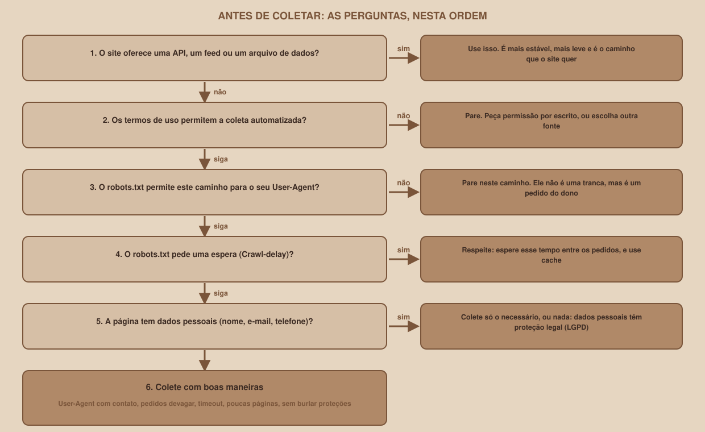

# Module 03, Ethics, Terms and robots.txt

[Português](../docs/03-etica-termos-e-robots-txt.md) · English

`WEEK 07 // Data & Scraping, Part 1: Collection`

---

## // Before you start

This module comes **before** the first scraper on purpose. A program that visits pages can cause real problems: overload a small server, read areas the owner asked to be left alone, or gather data about people that nobody authorized. Here you learn to ask "may I?" and "how do I do this politely?" before writing a single line of collection.

> **NOTICE**
> This module presents good practices and general notions. **It is not legal advice.** If you have a real doubt (a commercial project, data about people, a site you do not know), consult someone who understands the law.

## // The robots.txt file

Almost every site publishes, at the `/robots.txt` address, a file with **requests for robots**. It is plain text, and Mural Tech's is this one (real response):

```
# Mural Tech (site de treino): regras para robôs
User-agent: *
Allow: /vagas/
Allow: /eventos/
Disallow: /interno/
Crawl-delay: 1

User-agent: BotAbusivo
Disallow: /
```

Read it in groups. Each group starts with `User-agent` (who the group is addressed to: `*` means "everyone else") and continues with rules. In this file: any robot may visit `/vagas/` and `/eventos/`, must not visit `/interno/`, and must wait 1 second between requests. And the robot that identifies itself as `BotAbusivo` must not visit anything.

The standard that defines this file is **RFC 9309**, published in September 2022 (the documentation was checked on October 9, 2026). Three of its ideas need to be clear:

- **It is a request, not a lock.** The RFC expressly says these rules are not a form of access authorization. The server does not stop anyone. Whoever respects it is whoever **chooses** to respect it, and a decent scraper chooses to.
- **It is not security.** The RFC itself warns that listing a path in `robots.txt` makes it public and discoverable. Anyone who really wants to protect an area uses authentication, not a polite request.
- **Crawl-delay is not part of the standard.** The RFC only defines `User-agent`, `Allow` and `Disallow`, and says robots may interpret other records on their own. `Crawl-delay` is a widely used extra, and it is worth respecting anyway.

The proof that it is only a request is on the training site itself. The forbidden page (`/interno/relatorio`) **responds normally**:

```
a página proibida responde: 200 (o servidor não impede)
```

## // Reading robots.txt with Python

Python's standard library has a reader, `urllib.robotparser`. This script uses it to answer "may I collect this?":

```python
from urllib.robotparser import RobotFileParser

import requests

BASE = "http://127.0.0.1:8080"
SEU_AGENTE = "MuralColetaBot/1.0 (projeto de estudo; contato: voce@example.com)"

texto = requests.get(f"{BASE}/robots.txt", timeout=10).text

robots = RobotFileParser()
robots.parse(texto.splitlines())

for agente, caminho in [(SEU_AGENTE, "/vagas/"), (SEU_AGENTE, "/eventos/"),
                        (SEU_AGENTE, "/interno/relatorio"),
                        ("BotAbusivo/1.0", "/vagas/")]:
    pode = robots.can_fetch(agente, f"{BASE}{caminho}")
    print(f"{agente.split('/')[0]:14} {caminho:22} pode? {pode}")

print("Crawl-delay para o seu agente:", robots.crawl_delay(SEU_AGENTE))
```

```
MuralColetaBot /vagas/                pode? True
MuralColetaBot /eventos/              pode? True
MuralColetaBot /interno/relatorio     pode? False
BotAbusivo     /vagas/                pode? False
Crawl-delay para o seu agente: 1
```

(The complete script, which also prints the file, is in `03_robots.py`.) Notice that we download `robots.txt` with `requests` and hand the text to `parse()`. The reader's own `read()` method also exists, but it **does not accept a time limit**, and a scraper must never wait without a limit (Module 05). In tests on Python 3.12.3, before reading any rule `can_fetch` refuses everything, and after `parse()` it starts working.

## // When robots.txt fails

What if the file does not exist, or the server errors when delivering it? The RFC answers, and this week's collection client follows the answer:

| What happens with `/robots.txt` | What the RFC says | What the pipeline does |
|---|---|---|
| Responds `200` | Follow the rules | Follows the rules |
| A `4xx` error, such as `404` (does not exist) | "Unavailable": the robot **may** access everything | Collects, with no restrictions |
| A `5xx` error, or the network fails | "Unreachable": the robot **must** assume a complete block | **Collects nothing** and ends with a failure |

The logic is cautious: a `404` means "this site asked for nothing", but a server error means "I do not know what it asks", and when in doubt you do not collect.

## // Two traps of the Python reader

The standard library reader is simple, and that has a price. Two real tests show where it **diverges from the RFC**.

**1. Line order matters.** The RFC says the **most specific** rule (the one with the longest path) applies. The RFC's own example has `Allow: /example/page/` followed by `Disallow: /example/page/disallowed.gif`, and the `.gif` page must be **forbidden**. Python's reader **allows** it, because it uses the first rule that matches. With the two lines in reverse order, it forbids it.

**2. Wildcards do not work.** The RFC requires support for `*` (any sequence) and `$` (end of the address). With the rule `Disallow: /*.gif$`, Python's reader **does not block** `/a/b.gif`.

For sites with more elaborate `robots.txt` files, there is the **Protego** library (`pip install protego`; tested here at version 0.7.0), which follows the RFC in both cases:

```python
from protego import Protego

regras = Protego.parse(texto_do_robots)
pode = regras.can_fetch("http://127.0.0.1:8080/vagas/", "MuralColetaBot")
espera = regras.crawl_delay("MuralColetaBot")
```

```
RFC 5.2: /example/page/disallowed.gif pode? False  (o RFC manda proibir)
curinga /*.gif$ bloqueia /a/b.gif? True
crawl_delay: 3.0
```

Watch the **order of the arguments**, which is reversed compared with Python's reader: in Protego the address comes first, then the agent. Mural Tech's robots.txt is simple (no wildcards or overlapping rules), so the two readers agree, and the pipeline uses the standard library one. Swapping one for the other is the optional challenge in Module 14.

## // Beyond robots.txt

`robots.txt` is only one of the layers. The others matter just as much:

| Layer | The question | What to do |
|---|---|---|
| **Terms of use** | Does the site allow automated collection? | Read them. A site can forbid collection in its terms, **even if robots.txt allows it**. The most restrictive rule always applies |
| **API or data file** | Does the site offer an official way to get the data? | Use it. It is more stable, lighter on the server, and it is the path the owner wants |
| **Personal data** | Does the page show someone's name, e-mail or phone number? | Collect only what is necessary, or nothing. Under Brazil's General Data Protection Law (LGPD, Law No. 13,709/2018), personal data is information related to an identified or identifiable person |
| **Rights over the data** | May I store, show and redistribute what I collected? | Seeing a page or collecting it does not give you the right to republish it. Check the license before sharing |
| **Pace** | How many requests per second do I make? | The site's `Crawl-delay`, or at least one request per second. Concurrency is no excuse (Module 15) |
| **Identification** | Does the site know who I am? | Use an honest `User-Agent`, with the project name and a contact |
| **Cache** | Do I need to download this again? | No, if nothing changed (Module 11) |

Mural Tech lets you see the `User-Agent` reach the server. The `/eco` page returns the headers you sent:

```
User-Agent padrão: python-requests/2.34.2
pedido 1 pela sessão: MuralColetaBot/1.0
 (projeto de estudo; contato: voce@example.com)
```

(The real output writes the second value on a single line.)

Whoever receives thousands of requests a day reads this field. A clear name, with a contact, lets the site owner **talk to you** before blocking you.

## // The questions, in this order

<div align="center">

</div>

Before collecting from **any real site**, go through the diagram: is there an API? Do the terms allow it? Does `robots.txt` allow this path for your `User-Agent`? Is there a `Crawl-delay`? Does the page have personal data? Only then, collect with good manners.

## // What never to do

> **LINES THIS MATERIAL DOES NOT TEACH YOU TO CROSS**
> - Bypassing **login, captchas, IP blocks** or any of the site's protections.
> - Disguising the robot as a regular browser (changing the `User-Agent` to look like a person) to escape a block.
> - Ignoring `429`, `503` and `Retry-After`: they are the server asking you to slow down.
> - Collecting what is behind a restricted area.
> - Continuing after receiving a request to stop. If the site owner asks, **stop** and reply.

## // Good example × bad example

**Bad example**: a fake `User-Agent`, and no wait:

```python
cabecalhos = {"User-Agent": "Mozilla/5.0 (Windows NT 10.0; Win64; x64)"}
for numero in range(1, 1000):
    requests.get(f"{BASE}/vagas/?pagina={numero}", headers=cabecalhos)
```

The program lies about who it is, does not wait, has no time limit, and requests a thousand pages of a list that has three.

**Good example**: identified, slow, and with limits:

```python
sessao = requests.Session()
sessao.headers["User-Agent"] = SEU_AGENTE
time.sleep(espera)
resposta = sessao.get(url, timeout=10)
```

## // Common errors

| Error | Why it happens | How to fix it |
|---|---|---|
| `can_fetch` returns `False` for everything | It was called before reading the rules with `parse()` | Read `robots.txt` first |
| An "allowed" page is refused | Matching is by **prefix**: the rule `/busca` also blocks `/buscar` | Read the rules carefully, and test |
| A "forbidden" page is allowed | Matching is case-sensitive: `/admin/` does not block `/Admin/painel` | Test the variations, and do not trust the site to be consistent |
| A wildcard (`*` or `$`) is ignored | Python's reader does not implement wildcards | Use Protego |
| Thinking "the server answered 200, so it is allowed" | `robots.txt` is a request, not a lock | Respect the request, even without being forced to |

## // Guided practice

1. With Mural Tech running, open `http://127.0.0.1:8080/robots.txt` in the browser and read each line.
2. Run `03_robots.py` and check the permissions table.
3. Open `/interno/relatorio` in the browser: it opens. With that in mind, reread the sentence "it is a request, not a lock".
4. Run `curl http://127.0.0.1:8080/eco` and then `curl -A "MeuColetor/1.0" http://127.0.0.1:8080/eco`, and compare the `user-agent` returned in each case.

## // Practice on your own

> **CHALLENGE**
> Consider this `robots.txt`, for a robot called `MeuBot`:
> ```
> User-agent: *
> Disallow: /admin/
> Disallow: /busca
> Crawl-delay: 5
> ```
> For each address, say whether it is allowed: `/vagas/`, `/admin/painel`, `/busca?q=python`, `/buscar`, `/admin`, `/Admin/painel`. Then check with `RobotFileParser`. Answers, confirmed by both readers: allowed are `/vagas/`, `/admin` (the trailing slash is missing) and `/Admin/painel` (different capitalization); forbidden are `/admin/painel`, `/busca?q=python` and `/buscar` (prefix of `/busca`). The `Crawl-delay` is 5.

## // Applying it to the week's project

1. In your project folder, copy `03_robots.py` and run it.
2. In `anotacoes.md`, write your `User-Agent`, with your project name and an e-mail of yours (use a real address, in a real project). In this material, the contact is `voce@example.com`, a domain reserved for examples.
3. Create the "Questions before collecting" section and paste the five questions from the diagram. You will use them when adapting the pipeline to a real source.

## // Checkpoint

> **BEFORE MOVING ON, THINK ABOUT THIS**
> A site's `robots.txt` asks nothing against your robot, but the terms of use say "automated collection of content is prohibited". What do you do?

Answer: **you do not collect**, or you ask for permission in writing. `robots.txt` and the terms are different layers, and the most restrictive one applies. The fact that `robots.txt` does not forbid it only means the owner did not **configure** that request, not that they authorized it. And the fact that the server answers `200` proves nothing: it would answer anyone.

## // Module summary

- [ ] I can read a `robots.txt`: groups, `User-agent`, `Allow`, `Disallow` and `Crawl-delay`.
- [ ] I know it is a request, not a lock, and that it is not a security feature.
- [ ] I know what to do when it returns `404` and when it returns `5xx`.
- [ ] I know the standard library reader diverges from the RFC (line order and wildcards).
- [ ] I know the other layers: terms of use, API, personal data, pace, identification and cache.
- [ ] I know the lines not to cross, and I identify a robot with an honest `User-Agent`.

---

**Next module:** `04-essential-python-for-collection.md`, with the rules clear, what is left is preparing the tool: the Python environment and the essentials of the language.

`Study Material // Coffee & Code`
