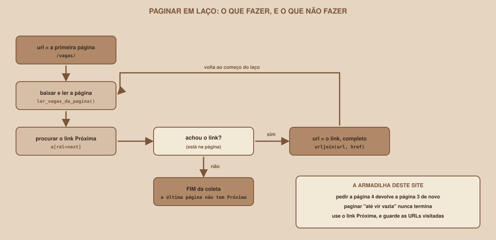

# Module 07, The First Scraper: Jobs

[Português](../docs/07-o-primeiro-scraper-vagas.md) · English

`WEEK 07 // Data & Scraping, Part 1: Collection`

---

## // Before you start

You already know how to request a page (Module 05), read the HTML (Module 06) and the rules of the game (Module 03). This module puts it all together in a program that does the **complete collection**: the job list, the detail of each job and every page. It is the week's first program that deserves the name scraper.

## // The plan

Mural Tech has 20 jobs, split into 3 pages of 8. To get all the data, the scraper needs two levels of visits:

1. Visit each **list page** (`/vagas/`, `/vagas/?pagina=2`, ...), and read the cards.
2. Visit the **detail** of each job (`/vagas/v002`), to get the description, which does not appear in the list.

That adds up to 3 list pages and 20 detail pages: **23 requests**, plus the `robots.txt`.

## // Paginating in a loop

<div align="center">

</div>

The idea: start on the first page, read the jobs, look for the **Próxima** ("Next") link, and, if it exists, repeat with its address. When a page has no such link, the collection is over. The `proxima_pagina()` function you wrote in `parsers.py` does the search (`a[rel=next]`) and already returns the full address.

### The trap: "until the page comes back empty"

Many people write the loop another way: "request page 1, page 2, page 3... until one comes back **empty**". On this site, that **never ends**. See the real result, with a safeguard that cuts it off at the sixth page (`07_a_armadilha_pagina_vazia.py`):

```
pedi a página 1: 8 vagas | Página 1 de 3 | v002..v007
pedi a página 2: 8 vagas | Página 2 de 3 | v010..v015
pedi a página 3: 4 vagas | Página 3 de 3 | v018..v019
pedi a página 4: 4 vagas | Página 3 de 3 | v018..v019
pedi a página 5: 4 vagas | Página 3 de 3 | v018..v019
pedi a página 6: 4 vagas | Página 3 de 3 | v018..v019
```

Requesting page 4 returns page 3 again, and it never comes back empty. Real sites behave in various ways with nonexistent pages: some return `404`, others return the last page, others return an empty page. There is no way to know in advance, which is why the right loop **does not depend on it**: it follows the Next link, and has **two safeguards**:

- a `visitadas` ("visited") set, so you never visit the same address twice;
- a `MAX_PAGINAS`, a ceiling on pages, in case everything else fails.

## // The complete scraper

This is `07_b_primeiro_scraper.py`, in full:

```python
import json
import time
from urllib.parse import urljoin
from urllib.robotparser import RobotFileParser

import requests

from parsers import ler_descricao, ler_html, ler_vagas_da_pagina, proxima_pagina

BASE = "http://127.0.0.1:8080"
USER_AGENT = "MuralColetaBot/1.0 (projeto de estudo; contato: voce@example.com)"
MAX_PAGINAS = 20

sessao = requests.Session()
sessao.headers["User-Agent"] = USER_AGENT

robots = RobotFileParser()
robots.parse(sessao.get(f"{BASE}/robots.txt", timeout=10).text.splitlines())
espera = float(robots.crawl_delay(USER_AGENT) or 0)
print(f"robots.txt lido. Espera entre pedidos: {espera} s")


def baixar(url):
    if not robots.can_fetch(USER_AGENT, url):
        raise RuntimeError(f"o robots.txt não permite {url}")
    time.sleep(espera)
    resposta = sessao.get(url, timeout=10)
    resposta.raise_for_status()
    return ler_html(resposta)


inicio = time.perf_counter()
vagas, visitadas = [], set()
url = urljoin(BASE, "/vagas/")
while url and url not in visitadas and len(visitadas) < MAX_PAGINAS:
    visitadas.add(url)
    sopa = baixar(url)
    da_pagina = ler_vagas_da_pagina(sopa, url)
    print(f"página {len(visitadas)}: {len(da_pagina)} vagas")
    for vaga in da_pagina:
        vaga["descricao"] = ler_descricao(baixar(vaga["url"]))
        vagas.append(vaga)
    url = proxima_pagina(sopa, url)

with open("vagas.json", "w", encoding="utf-8") as arquivo:
    json.dump(vagas, arquivo, ensure_ascii=False, indent=2)

print(f"total: {len(vagas)} vagas em {len(visitadas)} páginas")
print(f"tempo: {time.perf_counter() - inicio:.0f} s")
print("primeira:", vagas[0]["titulo"], "|", vagas[0]["empresa"])
print("descrição:", vagas[0]["descricao"][:50] + "...")
```

```
robots.txt lido. Espera entre pedidos: 1.0 s
página 1: 8 vagas
página 2: 8 vagas
página 3: 4 vagas
total: 20 vagas em 3 páginas
tempo: 23 s
primeira: Analista de Dados Pleno | Pinhão Dados
descrição: A Pinhão Dados procura uma pessoa para a posição d...
```

Four things deserve attention:

- **It respects robots.txt**: it reads the rules once, and checks **every address** with `can_fetch` before requesting it. A forbidden page raises an error instead of being visited.
- **It waits between requests**: it uses the site's own `Crawl-delay` (1 second). That is why 23 requests take **23 seconds**: the scraper is being polite, not slow.
- **It reuses your work**: reading the cards comes from the `parsers.py` of Module 06, and `baixar()` gathers the precautions of Module 05 (session, `timeout`, `raise_for_status`).
- **It writes to a file**: the result goes to `vagas.json`, for you to examine. The file has 20 items, each with the fields `descricao`, `empresa`, `id_externo`, `local`, `modalidade`, `nivel`, `publicada`, `salario`, `tags`, `titulo` and `url`.

> **ONE PIECE IS STILL MISSING: THE PROGRAM STOPS AT THE FIRST ERROR**
> In this first scraper, a page that fails brings down the whole collection, and the jobs already read are lost. Module 11 solves this with retries and failure isolation, and Module 12 saves what worked even when something fails.

## // Good example × bad example

**Bad example**: paginating by count, and never stopping:

```python
numero = 1
while True:
    vagas = ler(pedir(f"/vagas/?pagina={numero}"))
    if not vagas:
        break
    numero += 1
```

On this site, `vagas` is never empty, and the program requests pages forever.

**Good example**: follow the link, with safeguards:

```python
while url and url not in visitadas and len(visitadas) < MAX_PAGINAS:
    visitadas.add(url)
    ...
    url = proxima_pagina(sopa, url)
```

## // Common errors

| Error | Why it happens | How to fix it |
|---|---|---|
| The program never ends | It paginated "until empty", and the site repeats the last page | Follow the Next link, and use `visitadas` and `MAX_PAGINAS` |
| The program takes more than 20 seconds | It respects the 1 s `Crawl-delay` | That is expected: 23 requests, 1 s each |
| `RuntimeError: o robots.txt não permite ...` | It tried to visit a forbidden area | Remove that page from the plan |
| Links come as `/vagas/v002` and do not work | They are relative | Use `urljoin` (already done inside `parsers.py`) |
| The same job appears twice in the list | The page was visited twice | Check the `visitadas` set |
| `AttributeError: 'NoneType' object has no attribute 'get_text'` | A field was missing in a job | Use `texto()` (Module 06) |

## // Guided practice

1. Run `07_a_armadilha_pagina_vazia.py` and watch page 3 repeat.
2. Run `07_b_primeiro_scraper.py` and **wait the 23 seconds**: the pause is good manners in action.
3. Open `vagas.json` and check the fields of a job.
4. Change `espera` to `0`, run it again and see the difference. Then **go back to using the robots.txt value**: Mural Tech is local and can take it, but the habit is what counts.

## // Practice on your own

> **CHALLENGE**
> Read `vagas.json` and count how many jobs each company has, with `collections.Counter`. Expected result: the 5 companies (Orbita Software, Pinhão Dados, Araucária Labs, Cafeteria Digital and Serra Azul Tech) appear with **4 jobs each**, adding up to 20. Then print the titles of the jobs that have `python` in their tags.

## // Applying it to the week's project

1. In the project folder, create `coletar_vagas.py` with this module's code, importing the functions from your `parsers.py`.
2. Run it and check `vagas.json`.
3. If you version with Git, make a commit: `git commit -m "Adiciona o primeiro scraper de vagas"`. Do not include `vagas.json` (it is output, not code).

## // Checkpoint

> **BEFORE MOVING ON, THINK ABOUT THIS**
> Your scraper runs fine for weeks. One day, the site adds a fourth page, and the third page's "Next" link starts pointing to it. Does your scraper need to change?

Answer: **no**. Since it **follows the link** instead of counting pages, the fourth page will be visited naturally, and the collection will end on the one that has no link. A scraper with the number `3` written in the code would miss the new page without warning. The lesson goes beyond pagination: whenever the site already **tells** you something (where the next page is, what the id is), use what it tells you instead of guessing.

## // Module summary

- [ ] I can split collection into two levels: the list and the detail.
- [ ] I can paginate in a loop, following the Next link.
- [ ] I know why "until the page comes back empty" is a trap, and I use `visitadas` and `MAX_PAGINAS`.
- [ ] I can respect `robots.txt` and `Crawl-delay` inside the code.
- [ ] I can save the result in a JSON file.
- [ ] I know the program still stops at the first error, and that this will be fixed.

---

**Next module:** `08-cleaning-and-normalizing.md`, the data has arrived. But `R$ 7.000 a R$ 9.500` is still just text.

`Study Material // Coffee & Code`
