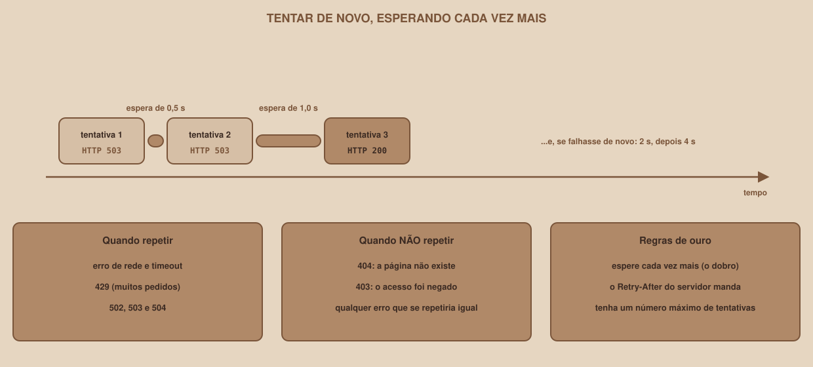

# Module 11, Robustness and Good Manners

[Português](../docs/11-robustez-e-boas-maneiras.md) · English

`WEEK 07 // Data & Scraping, Part 1: Collection`

---

## // Before you start

So far, the scraper works **when everything goes right**. On the web, not everything goes right: servers go down for a minute, ask you to slow down, change their HTML. A scraper that runs on its own, at night, needs to **cope with this with nobody around**. This module teaches four defenses: try again, wait when the server asks, do not download what has not changed, and notice when the site has changed.

## // Try again, waiting longer each time

<div align="center">

</div>

Some errors **go away on their own**: a `503` (the server is unavailable right now) usually disappears in seconds. For those, it is worth **trying again**. But with two rules: wait between attempts, and wait **longer each time** (double each time), so you do not hammer a server that is already struggling. This script (`11_a_tentativas.py`) tries an address that fails twice and then works:

```python
def baixar_com_tentativas(url, tentativas=4, base=0.5):
    for numero in range(1, tentativas + 1):
        inicio = time.perf_counter()
        resposta = requests.get(url, timeout=10)
        gasto = time.perf_counter() - inicio
        print(f"tentativa {numero}: HTTP {resposta.status_code} ({gasto:.2f} s)")
        if resposta.status_code < 500:
            return resposta
        if numero < tentativas:
            espera = base * 2 ** (numero - 1)
            print(f"   servidor indisponível: esperando {espera} s")
            time.sleep(espera)
    raise RuntimeError(f"{url}: sem sucesso em {tentativas} tentativas")
```

```
tentativa 1: HTTP 503 (0.00 s)
   servidor indisponível: esperando 0.5 s
tentativa 2: HTTP 503 (0.00 s)
   servidor indisponível: esperando 1.0 s
tentativa 3: HTTP 200 (0.00 s)
deu certo: 200 | bytes: 4122
```

The wait was `0.5`, then `1.0`: it is the base, multiplied by 2 raised to the attempt number minus 1 (the math is in the code). And there is a **maximum number of attempts**. With an address that fails five times and `tentativas=4`, the real result is:

```
tentativa 4: HTTP 503 (0.00 s)
RuntimeError: ...sem sucesso em 4 tentativas
```

after 3.5 seconds of waiting (0.5 + 1 + 2). Without that ceiling, a server that is down would trap your program forever.

### What to retry, and what not to

| Retry | Do not retry |
|---|---|
| Network errors and `Timeout` | `404`: the page does not exist, and will keep not existing |
| `429` (too many requests) | `403`: access was denied |
| `502`, `503` and `504` (the server has a problem) | Any error that would repeat identically |

## // When the server says how long to wait

A polite server says **how long** to wait, in the `Retry-After` header. Mural Tech has a page that accepts only 3 requests every 5 seconds (`/limitado/vagas`). The `11_b_retry_after.py` script requests it five times:

```python
for numero in range(1, 6):
    resposta = requests.get(f"{BASE}/limitado/vagas", timeout=10)
    print(f"pedido {numero}: HTTP {resposta.status_code}")
    if resposta.status_code == 429:
        pedido = float(resposta.headers["Retry-After"])
        print(f"   o servidor pediu {pedido:.0f} s: eu espero esse tempo")
        time.sleep(pedido)
```

```
pedido 1: HTTP 200
pedido 2: HTTP 200
pedido 3: HTTP 200
pedido 4: HTTP 429
   o servidor pediu 5 s: eu espero esse tempo
pedido 5: HTTP 200
```

The fourth request got `429`, the server asked for 5 seconds, the program waited, and the fifth worked. **Obeying Retry-After is better than guessing**: the server knows when it will free up.

## // The pipeline's client

The client the pipeline uses, in the `http.py` file, puts all of this together: the `robots.txt` rules (Module 03), the wait between requests, the `timeout`, the retries, `Retry-After` and the ceiling. The `obter` ("get") method is its heart:

```python
    def obter(self, url: str, params: dict | None = None) -> requests.Response:
        if not self.pode(url):
            raise BloqueadoPorRobots(f"o robots.txt não permite: {url}")
        motivo = "sem resposta"
        total = self.config.max_tentativas
        for tentativa in range(1, total + 1):
            self._respeitar_espera()
            retry_after = None
            try:
                resposta = self.sessao.get(
                    url, params=params, timeout=self.config.timeout
                )
            except (requests.Timeout, requests.ConnectionError) as erro:
                motivo = type(erro).__name__
            else:
                self.pedidos += 1
                codigo = resposta.status_code
                if codigo not in STATUS_REPETIVEIS:
                    if codigo >= 400:
                        raise ErroDeColeta(f"{url}: HTTP {codigo}")
                    return resposta
                motivo = f"HTTP {codigo}"
                retry_after = resposta.headers.get("Retry-After")
            if tentativa < total:
                espera = self._espera_da_tentativa(tentativa, retry_after)
                self.repeticoes += 1
                log.warning("%s em %s: tentativa %d de %d, esperando %.1fs",
                            motivo, url, tentativa, total, espera)
                self.dormir(espera)
        raise ErroDeColeta(f"{url}: {motivo} depois de {total} tentativas")
```

And the calculation of each attempt's wait:

```python
    def _espera_da_tentativa(self, tentativa: int, retry_after) -> float:
        base = min(self.config.espera_maxima,
                   self.config.espera_base * 2 ** (tentativa - 1))
        espera = base + random.uniform(0, base * 0.1)
        try:
            pedido = float(retry_after)
        except (TypeError, ValueError):
            return espera
        return max(espera, min(pedido, self.config.espera_maxima))
```

Read it calmly, because each line is one of this module's lessons:

- The math `espera_base` times 2 raised to `tentativa - 1`: the wait doubles (0.5 s, 1 s, 2 s, 4 s...).
- `min(self.config.espera_maxima, ...)`: it **never** goes past 30 seconds.
- `random.uniform(0, base * 0.1)`: a small **random variation**, so several programs that failed together do not retry at exactly the same time.
- `max(espera, min(pedido, ...))`: if the server asked for a time (`Retry-After`), the **larger** of the request and the calculation applies, capped at the maximum.
- A `Retry-After` that is not a number (the HTTP standard allows a date) is **ignored**, and the client's own calculation applies. An automated test checks this.
- `404` and other errors that would repeat raise `ErroDeColeta` ("collection error") **right away**, without retrying.

> **WHAT ABOUT THE READY-MADE LIBRARY?**
> `requests` can also retry on its own, with `urllib3`'s `Retry` class, mounted on a session. Running against the same unstable address: `status final: 200 | repeticoes feitas: 2 | [503, 503]`. It works well for the simple case. This material writes the loop by hand because, that way, each decision (the ceiling, `Retry-After`, the log entry) stays visible and testable.

## // Asking "did it change?" before downloading

Downloading a page that **has not changed** again is a waste, for you and for the server. HTTP solves this with the `ETag`, the page's fingerprint (Module 01). You keep the `ETag` from last time and send it back in the `If-None-Match` header. If the page has not changed, the server answers `304` **with no body**. The `11_c_condicional.py` script shows it:

```
1ª vez: 200 | bytes recebidos: 4122
ETag guardada: "d3aa7cdebab346b2"
2ª vez: 304 | bytes recebidos: 0
página 2 tem outra ETag: True
no dia seguinte: 200 | bytes recebidos: 4103
```

The second time, **zero bytes**: the server only confirmed that nothing changed. And, the next day (when the content changed), the whole page came again. This feature requires the **server** to offer it, and a scraper that uses it needs to **keep the previous page** (or its data), because a `304` brings no content. That is why this week's pipeline, which always rereads everything to know what disappeared, does not use it, and it remains a technique for large collections.

## // Noticing that the site changed

In Module 06, you saw that handling missing fields avoids crashes, but **hides changes on the site**. The defense is **counting**: if a large share of the fields comes empty, something changed. The `11_d_campos_vazios.py` script implements the alarm, with a 30% limit:

```python
def conferir(vagas, campo):
    vazios = sum(1 for v in vagas if not v[campo])
    proporcao = vazios / len(vagas)
    estado = "ALARME" if proporcao > LIMITE else "ok"
    print(f"{campo}: {vazios} de {len(vagas)} vazios ({proporcao:.0%}) "
          f"-> {estado}")
```

Run with the right selector and then with an "old" selector (the site renamed the class), the real result is:

```
seletor certo (.salario):
salario: 0 de 8 vazios (0%) -> ok
o site mudou o nome da classe para .remuneracao, e o seletor ficou velho:
salario: 8 de 8 vazios (100%) -> ALARME
```

That is how you find out, in a day, what would otherwise take weeks: the data keeps arriving, with no error, but **empty**. In a real pipeline, the alarm would become a warning in the log and a `parcial` (partial) status on the run.

## // Isolating failures

A page that fails **must not bring down the whole collection**. See how the job collector (`coletores.py`) handles a failure on a job's **detail** compared with a failure on a **list page**:

| Where it fails | What the collector does | Why |
|---|---|---|
| The detail of **one** job | Logs the error, keeps the job and **preserves the last known description** (if there never was one, it stays empty), and moves on | "I could not fetch it today" is not the same as "the page does not have it": a passing error must not erase good data |
| A **list page** | Logs the error, **stops the collection** and sets `completo = False` | You do not know which jobs are missing, and the orchestrator **deactivates** nobody |
| An item that **exists, but came broken** (job without a title or a link) | Logs the error, discards the item and sets `completo = False` | It appeared on the site: it cannot be treated as "gone" |
| Pagination in a **cycle** | Logs "ciclo detectado" ("cycle detected") and sets `completo = False` | The pages after the cycle were never visited |
| `robots.txt` forbids the address (including a detail one) | **Stops everything** | It is not a passing failure: it is a rule |

The automated tests confirm every line of this table. Of the project's 79 tests, 16 are for the HTTP client (`test_http.py`), and they cover: the `Crawl-delay` wait, blocking by `robots.txt`, the repeated `503`, `Retry-After` being obeyed, the `404` that is not retried, `Timeout`, a missing `robots.txt` (which allows collection) and a `robots.txt` with a server error (which blocks it). And there is the **reverse proof**: when you deliberately turn off respect for `robots.txt` in the code, the corresponding test **fails**, which proves it really protects you.

## // Good example × bad example

**Bad example**: retrying without waiting, and without end:

```python
while True:
    resposta = requests.get(url)
    if resposta.ok:
        break
```

If the server is down, the program **attacks it nonstop**, and never ends.

**Good example**: few attempts, growing waits, and respect for `Retry-After`:

```python
resposta = cliente.obter(url)    # o Cliente do pipeline faz tudo isto
```

## // Common errors

| Error | Why it happens | How to fix it |
|---|---|---|
| The program attacks a struggling server | It retries without waiting | Use growing waits and a ceiling on attempts |
| More `429` with each attempt | It ignores `Retry-After` and the server's window | Wait what the server asked for |
| It retries a `404` four times | It treats every error as temporary | Only retry `429`, `502`, `503`, `504` and network errors |
| The data arrives empty, with no error | The site changed its HTML | Count the empty fields and raise an alarm |
| One bad page brings down the whole collection | The failure was not isolated | Catch the error per page, and log it |
| Every program retries at the same time | Identical waits | Add a small random variation |

## // Guided practice

1. Run `11_a_tentativas.py` and check the 0.5 s and 1.0 s waits.
2. Run `11_b_retry_after.py` and watch the `429` and the 5-second wait.
3. Run `11_c_condicional.py` and confirm the `304` with zero bytes.
4. Run `11_d_campos_vazios.py` and watch the alarm go off.
5. Run `pytest tests/test_http.py` and read the test names: they describe the client's behavior.

## // Practice on your own

> **CHALLENGE**
> Change `11_a_tentativas.py` to request `/instavel/vagas?chave=NOVA&falhas=5`, with `tentativas=4`. What happens? Expected result: all four attempts get `503`, the waits are 0.5 s, 1.0 s and 2.0 s (3.5 s in total), and the program ends with `RuntimeError: ... sem sucesso em 4 tentativas`. Then switch to `tentativas=6` with `falhas=5`: the sixth request works. How much waiting time was spent in total? (0.5 + 1 + 2 + 4 + 8 = 15.5 s.)

## // Applying it to the week's project

1. In the project folder, create `http.py` with the polite client (robots, wait, retries), building on what you put together in Modules 03 and 05.
2. Replace your `baixar()` with `cliente.obter()`.
3. Add a count of empty fields to your collector, and print a warning if it goes over 30%.

## // Checkpoint

> **BEFORE MOVING ON, THINK ABOUT THIS**
> Your pipeline runs every night, and the server answers `503` with `Retry-After: 120` (two minutes) for several minutes. Your client waits at most 30 seconds per attempt and makes 4 attempts. What happens?

Answer: the client waits 30 seconds (the ceiling) after each failure, and after 4 attempts it **gives up** with `ErroDeColeta`, even though the server had asked for 2 minutes. This is intentional: the ceiling protects your program from being stuck for too long. The failed page goes into the error list, the run ends as **partial**, and the orchestrator **deactivates** nobody (the collection was not complete). Tomorrow, the pipeline tries again, with the server, hopefully, recovered. Failing gracefully is better than waiting endlessly.

## // Module summary

- [ ] I can retry with growing waits and a ceiling on attempts.
- [ ] I know which errors to retry and which not to.
- [ ] I can obey `Retry-After`, and ignore a value I cannot read.
- [ ] I can use `ETag` and `If-None-Match`, and I know when it pays off.
- [ ] I can count empty fields to notice that the site changed.
- [ ] I can isolate a failure per page, without bringing down the whole collection.

---

**Next module:** `12-the-end-to-end-pipeline.md`, every piece is ready. Now, put it all together in a program that runs on its own.

`Study Material // Coffee & Code`
