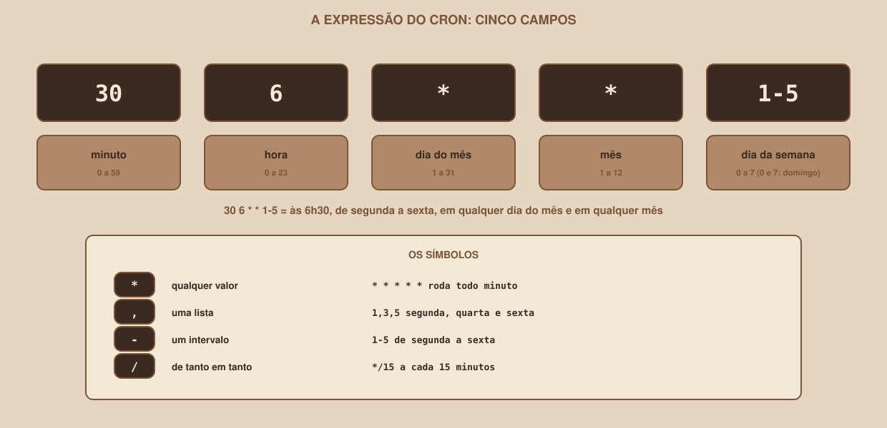

# Module 13, Scheduling the Collection

[Português](../docs/13-agendando-a-coleta.md) · English

`WEEK 07 // Data & Scraping, Part 1: Collection`

---

## // Before you start

A pipeline that only runs when you remember to run it is not automation. This module puts the Module 12 pipeline to run **on its own**, at fixed times, and teaches what changes when nobody is in front of the terminal: absolute paths, logs in files, and protection against overlapping runs.

> **WHAT WAS AND WAS NOT TESTED IN THIS MODULE**
> These were verified with real runs: the **scheduling expressions** (with the `croniter` library), the **script the scheduler calls**, the **exit code** and the **lock** against double runs. **It was not possible to test** `cron` itself (it was not available in the production environment), nor the Windows Task Scheduler, nor macOS `launchd`. The instructions for these three follow the known conventions, and **you should check them** on your system.

## // What cron is

**cron** is the task scheduler of Linux and macOS systems: a program that keeps running and, every minute, checks a list of tasks ("run this at 7:00 every day") and fires the ones whose time has come. You edit your list with the `crontab -e` command, and each line has **five time fields**, followed by the command.

<div align="center">

</div>

Read `30 6 * * 1-5` like this: minute `30`, hour `6`, any day of the month, any month, weekdays `1` to `5` (Monday to Friday). That is: **at 6:30, Monday to Friday**.

## // Checking an expression before using it

Getting the expression wrong is easy, and the error only shows up on the day the task does not run. That is why it is worth **checking** first. The `croniter` library (`pip install croniter`, tested at version 6.2.4) calculates an expression's next runs. Starting from a Saturday, 10/10/2026 (October 10), at 06:30, the real results are:

```
0 7 * * *      -> ['Sat 10/10 07:00', 'Sun 11/10 07:00', 'Mon 12/10 07:00']
30 6 * * 1-5   -> ['Mon 12/10 06:30', 'Tue 13/10 06:30', 'Wed 14/10 06:30']
*/15 * * * *   -> ['Sat 10/10 06:45', 'Sat 10/10 07:00', 'Sat 10/10 07:15']
0 7 1 * *      -> ['Sun 01/11 07:00', 'Tue 01/12 07:00', 'Fri 01/01 07:00']
```

(The dates are in day/month format.) Check what this teaches: `30 6 * * 1-5`, on a **Saturday**, only fires on **Monday**; `*/15` fires every 15 minutes; `0 7 1 * *` fires only on the 1st of each month. And the library also **validates** expressions:

```
valida? '0 7 * * *'      True
valida? '61 * * * *'     False
valida? '0 25 * * *'     False
valida? '* * * *'        False
```

(Minute 61, hour 25 and an expression with only four fields are refused.) A detail about the weekday: `0` and `7` are both Sunday, which was also confirmed.

## // The script the scheduler calls

When cron fires a command, it **is not** your terminal: it does not have the virtual environment activated, it is not in the project folder, and it does not have your variables. That is why the scheduler should not call `python -m coleta` directly: it calls a **short script**, which prepares everything. This is `executar_pipeline.sh`:

```bash
#!/usr/bin/env bash
# Executa o pipeline de coleta. Feito para ser chamado pelo cron.
# Ajuste PROJETO e PYTHON para os caminhos do SEU computador (sempre absolutos).
set -u

PROJETO="${PROJETO:-$(cd "$(dirname "$0")/../pipeline" && pwd)}"
PYTHON="${PYTHON:-$PROJETO/.venv/bin/python}"
LOG="$PROJETO/logs/cron.log"

mkdir -p "$PROJETO/logs"
cd "$PROJETO" || exit 2

{
  echo "=== $(date '+%Y-%m-%d %H:%M:%S') inicio"
  "$PYTHON" -m coleta "$@"
  codigo=$?
  echo "=== $(date '+%Y-%m-%d %H:%M:%S') fim (codigo $codigo)"
} >> "$LOG" 2>&1

exit "$codigo"
```

What it does, line by line:

- `set -u`: error if you use a variable that does not exist.
- `PROJETO` and `PYTHON`: **absolute paths**. The default derives the project folder from the script itself, and uses the Python **of the virtual environment** (`.venv/bin/python`), with the right libraries. You can override both variables.
- `LOG`: the scheduler's own log file (`logs/cron.log`).
- `cd "$PROJETO" || exit 2`: goes into the project folder (the pipeline creates `dados/` and `logs/` relative to it), and **exits with an error** if it cannot.
- The `{ ... } >> "$LOG" 2>&1` block: **everything** the pipeline writes (normal output and error output) goes to the file, and is not lost, since nobody is watching the terminal. It marks the start and end time, and keeps the exit code.
- `exit "$codigo"`: returns the pipeline's **same code**. Without it, the scheduler would think it always worked.

## // What was verified about the script

These are real results, running the script with Mural Tech up:

```
codigo do wrapper: 0
--- duas execucoes ao mesmo tempo:
segunda execucao: codigo 3
primeira execucao: codigo 0
```

The first run ended with `0`. When **two** were fired almost together, the second found the lock (Module 12), refused to run and exited with code `3`, while the first carried on normally and ended with `0`. The `cron.log` file recorded everything:

```
=== DATA HORA inicio
=== DATA HORA fim (codigo 0)
=== DATA HORA inicio
=== DATA HORA inicio
DATA HORA ERROR   outra execução está em andamento: saindo
=== DATA HORA fim (codigo 3)
=== DATA HORA fim (codigo 0)
```

(The dates and times were replaced with `DATA HORA`.)

## // The crontab line

With the script ready, the `crontab` line is short. This is the `crontab.exemplo` file:

```
# Edite com:  crontab -e
#
# minuto  hora  dia-do-mês  mês  dia-da-semana   comando
#
# Todo dia, às 7h da manhã:
0 7 * * *     /caminho/absoluto/para/executar_pipeline.sh

# De segunda a sexta, às 6h30:
# 30 6 * * 1-5  /caminho/absoluto/para/executar_pipeline.sh

# A cada 15 minutos (só para testar o agendamento, nunca em um site real):
# */15 * * * *  /caminho/absoluto/para/executar_pipeline.sh
```

Three rules for the cron line:

1. **Always an absolute path**: `/caminho/absoluto/para/executar_pipeline.sh`, not `./executar_pipeline.sh`. Find the path with `pwd`.
2. **The script must be executable**: `chmod +x executar_pipeline.sh`.
3. **Do not schedule more often than necessary.** The every-15-minutes example is only for testing the schedule. Jobs and events change once a day: **one daily run** is enough, and it is what a real site tolerates without being bothered.

## // Windows and macOS

> **NOT TESTED**
> Nothing in this section was run: the material was produced on Linux. Treat it as a starting point, and check your system's documentation.

On **Windows**, cron's equivalent is the **Task Scheduler**, and you can create a task from the terminal with the `schtasks` command. The `agendar_windows.txt` file has the steps, and `executar_pipeline.bat` is the equivalent of the script above. It creates the `logs` folder if it does not exist (the output redirect would fail before Python had the chance to create it) and quotes the paths, to accept names with spaces:

```
Agendador de Tarefas do Windows (NAO TESTADO: o material foi produzido em Linux).

Pelo terminal (Prompt de Comando), todo dia as 07:00:

  schtasks /Create /SC DAILY /ST 07:00 /TN "ColetaMuralTech" ^
           /TR "C:\Users\voce\projeto-coleta\agendamento\executar_pipeline.bat"

Se o caminho do .bat tiver ESPACOS, o valor de /TR precisa de aspas internas
(escapadas com barra invertida) e o comando deve ser conferido no seu sistema.

Para conferir, rodar agora e remover:

  schtasks /Query /TN "ColetaMuralTech"
  schtasks /Run /TN "ColetaMuralTech"
  schtasks /Delete /TN "ColetaMuralTech" /F
```

(The file says, in Portuguese: if the `.bat` path has spaces, the `/TR` value needs inner quotes, escaped with a backslash, and the command should be checked on your system.)

On **macOS**, `cron` also exists, and the system offers `launchd` as a modern alternative. We have no tested walkthrough for it.

## // Knowing whether the schedule is working

Scheduling and forgetting is how things break silently. Two ways to check:

**1. Look at the log file.** `cron.log` (from the script) and `coleta.log` (from the pipeline) show each run. On Linux and macOS, `tail -n 20 logs/cron.log` shows the last lines.

**2. Ask the database.** The `execucoes` table (Module 12) keeps each run. This query counts the successful runs in the last 26 hours (one day, with some slack):

```sql
SELECT count(*) FROM execucoes
WHERE status IN ('ok', 'parcial')
  AND datetime(inicio) >= datetime('now', 'localtime', '-26 hours');
```

If the result is `0`, nobody collected anything in the last day, and something needs attention.

The `datetime(inicio)` on the left side **is not decoration**. The `inicio` ("start") column is text: the pipeline writes `2026-10-10T07:00:00.123456` (with a `T`), and SQLite returns the `datetime(...)` date with a **space**. Comparing the two **as text** gives the wrong result, because `T` comes after the space in character order: `'2026-10-10T07:00:00' >= '2026-10-10 10:00:00'` is `1`, even though 07:00 is **before** 10:00. With `datetime()` on both sides, it is `0`. In a test with four runs (from 3 h, 30 h and 80 h ago, and one 1 hour before the 26 h limit), the query without `datetime(inicio)` counted **3**, and the fixed one counted **1**, which is right. `datetime()` understands the microsecond timestamp the pipeline writes. (`localtime` compares on the same clock the pipeline uses to write the start time.) In the tests, the result after three runs was `3`. Hooking this query up to an alert (by e-mail, for example) is outside this week's scope.

## // Good example × bad example

**Bad example**: calling Python directly, with a relative path, with no log:

```
0 7 * * *  python -m coleta
```

When cron runs, it is not in the project folder, and `python` may not even be the virtual environment's. The error is lost, because the output goes nowhere.

**Good example**: a script that prepares everything, and a line with an absolute path:

```
0 7 * * *  /caminho/absoluto/para/executar_pipeline.sh
```

## // Common errors

> **ATTENTION**
> The table below gathers the **best-known** problems of scheduled tasks. They follow the documentation and general practice, and **were not reproduced** in this environment, unlike the expressions, the script and the lock, which were.

| Error | Why it happens | How to fix it |
|---|---|---|
| "Command not found", or missing library errors | cron runs with a minimal environment, without your virtual environment | Call the virtual environment's Python by absolute path, as the script does |
| The task never runs | The expression is wrong, or the script is not executable | Check the expression with `croniter`, and run `chmod +x` |
| Nobody knows what happened | The output did not go to a file | Redirect `>> arquivo 2>&1`, as the script does |
| Two runs trip over each other | The previous one has not finished yet | The pipeline's lock (code `3`) |
| It runs at the "wrong" time | cron uses the system's clock and time zone | Check the system time, and write the time in your expression |
| The pipeline asks too much of the site | It was scheduled too often | Once a day is enough |

## // Guided practice

1. Install `croniter` (`pip install croniter`) and list the next runs of `0 7 * * *`.
2. Run `executar_pipeline.sh` by hand (with `PROJETO` and `PYTHON` pointing to your project and your virtual environment) and check `logs/cron.log`.
3. Run the script **twice at the same time** (one in each terminal) and confirm code `3` on the second.
4. If you use Linux or macOS, run `crontab -e` and write a line with **a test expression** (every 5 minutes, for example), wait for the time and check the log. **Remove the line afterwards.**

## // Practice on your own

> **CHALLENGE**
> Write the cron expression to run **every Monday, Wednesday and Friday, at 7:15**, and check it with `croniter`. Answer: `15 7 * * 1,3,5`. Starting from Saturday, 10/10/2026, at 06:30, the next runs are Monday 12/10, Wednesday 14/10 and Friday 16/10, all at 07:15.

## // Applying it to the week's project

1. In the project folder, create the `agendamento/` folder with `executar_pipeline.sh` (or the `.bat`, on Windows).
2. Adjust `PROJETO` and `PYTHON` to your paths.
3. Write your schedule line for **once a day**, and check the expression with `croniter`.
4. Keep the last-26-hours query in a `conferir.sql` file.

## // Checkpoint

> **BEFORE MOVING ON, THINK ABOUT THIS**
> Your schedule runs every day at 7:00. For a week, nobody looks at the database. The following Monday, you discover it **stopped collecting on Tuesday**. Which defenses from this module and the previous one would help you notice earlier?

Answer: the **exit code** (`1` or `2` when there is a problem) shows up in `cron.log` and, in a more complete scheduler, could trigger an alert; the **execucoes table** has each day's status, and the **last-26-hours query** would return `0` on Wednesday morning; and the **log** would show the error. The lesson is that automation without **observation** is just a way of failing silently: the part that runs on its own needs to come with the part that warns when it stops.

## // Module summary

- [ ] I can read a cron expression: the five fields, and the `*`, `,`, `-` and `/` symbols.
- [ ] I can check an expression with `croniter` before using it.
- [ ] I know why the scheduler calls a script, and what it prepares.
- [ ] I know the exit code needs to reach the scheduler.
- [ ] I know one run a day is enough, and that the lock prevents overlapping runs.
- [ ] I can check whether collection is running, through the log and the `execucoes` table.
- [ ] I know what was **not** tested in this module: `cron` itself, Windows and macOS.

---

**Next module:** `14-guided-project.md`, all the pieces are ready. Let us build the deliverable and check it, item by item.

`Study Material // Coffee & Code`
