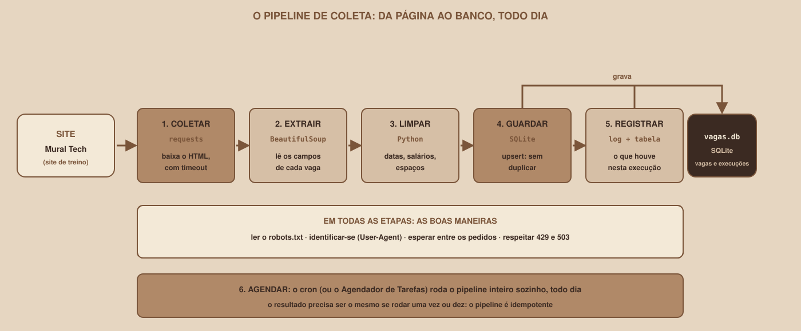

# Módulo 00, Comece Aqui

Português · [English](../docs-eng/00-start-here.md)

`SEM 07 // Data & Scraping, Parte 1: Coleta`

---

## // Bem-vindo à Semana 07

Imagine que você quer acompanhar as vagas de tecnologia e os eventos que aparecem em vários sites da sua cidade. Abrir cada site todo dia é cansativo. Copiar e colar à mão é pior: você esquece uma página, cola um dado errado, perde o que mudou desde ontem. Agora imagine um programa que faz esse trabalho sozinho: visita as páginas, lê as vagas e os eventos, guarda tudo em um banco de dados e, no dia seguinte, só acrescenta o que é novo.

Essa é a ideia desta semana. Os dados que interessam estão **dentro de páginas feitas para pessoas lerem**, e não para programas consumirem. Aprender a extraí-los de forma organizada, educada e repetível é o assunto da **coleta de dados**.

> **ESTA SEMANA É INDEPENDENTE**
> Esta é a Parte 1 do módulo "Data & Scraping" (a coleta), mas foi escrita para ser lida **sozinha**. Você não precisa ter estudado nada antes: o HTML, o Python e o SQL de que a coleta precisa são apresentados do zero, no tamanho certo.

## // O que é web scraping

> **WEB SCRAPING: EM PALAVRAS SIMPLES**
> É usar um programa para baixar páginas web e **extrair delas dados estruturados**, como o título, a empresa e o salário de cada vaga. O programa faz o que uma pessoa faria no navegador (abrir a página, ler, anotar), só que rápido, sem cansar e de forma repetível.

Um scraper junta quatro habilidades, que são os módulos desta semana: **pedir** uma página (a biblioteca `requests`), **ler** o HTML (a biblioteca BeautifulSoup), **guardar** o que foi lido (o banco SQLite) e **repetir** tudo sozinho (a automação).

> **ANTES DE QUALQUER CÓDIGO: BOAS MANEIRAS**
> Pegar dados de um site não é o mesmo que olhar uma página. Um robô pode sobrecarregar um servidor, ler áreas que o dono pediu para não visitar, ou coletar dados pessoais que a lei protege. O Módulo 03 é inteiro sobre isso, e vem **antes** do primeiro scraper de propósito. Nesta semana, tudo o que você coleta vem de um site de treino criado para isso.

## // O pipeline de coleta

Um **pipeline** (em português, "tubulação") é uma sequência de etapas em que a saída de uma é a entrada da seguinte. O desta semana tem cinco etapas e um agendamento:

| Etapa | O que faz | Ferramenta |
|---|---|---|
| 1. Coletar | Baixa o HTML da página, com um tempo limite | `requests` |
| 2. Extrair | Lê o HTML e separa os campos de cada vaga | BeautifulSoup |
| 3. Limpar | Padroniza datas, salários e textos | Python |
| 4. Guardar | Grava no banco **sem duplicar** o que já existe | SQLite |
| 5. Registrar | Anota o que aconteceu nesta execução | `logging` e uma tabela |
| 6. Agendar | Repete tudo sozinho, todo dia | `cron` |

## // O que você vai construir

- Um **site de treino**, o Mural Tech, que roda no seu computador e se comporta como um site de verdade: tem paginação, `robots.txt`, páginas que demoram, erros `429` e `503`, e uma página montada por JavaScript.
- **Scripts de coleta** que extraem as vagas e os eventos do Mural Tech.
- Um **pipeline completo** que grava os dados em um banco SQLite, **sem duplicar**, e registra cada execução.
- Um **agendamento** que roda esse pipeline sozinho.

## // Por que um site de treino, e não um site real

Há três motivos, e o terceiro é o mais importante:

1. **Sites reais mudam.** Um site muda o HTML sem aviso, e um tutorial que funcionava ontem quebra hoje. O Mural Tech não muda, a não ser quando você pede.
2. **Muitos sites proíbem a coleta** nos termos de uso, ou a limitam. Praticar em um site que você tem permissão de usar evita problemas.
3. **Você pode errar à vontade.** Um laço que pede mil páginas por engano derruba o seu site de treino, e não o de uma empresa.

O Módulo 03 ensina a avaliar um site real, e o Módulo 14 traz um passo opcional de adaptação para quem quiser levar o pipeline a uma fonte real e permitida.

## // O que fica de fora

> **AINDA NÃO NESTA SEMANA**
> **A análise dos dados** (gráficos, estatísticas) fica para a Parte 2. Também ficam de fora: login, captchas e qualquer forma de **burlar proteções** de um site (isso nunca é ensinado aqui), bancos de dados de servidor (como o PostgreSQL), publicação na nuvem e a coleta de dados pessoais.

## // O que você precisa para começar

- Um computador com Windows, macOS ou Linux e permissão para instalar programas.
- **Python 3.10 ou superior** (o Módulo 04 mostra como conferir e como preparar o ambiente).
- Um editor de texto ou de código e um terminal.
- Conexão com a internet **só para instalar** as bibliotecas: o site de treino roda no seu computador.
- **Nenhum conhecimento prévio** de HTML, SQL ou scraping. O Python básico é revisado no Módulo 04.

> **VERSÕES, DATA DE CONSULTA E O QUE FOI TESTADO**
> O material foi verificado com **Python 3.12.3**, `requests` 2.34.2, `beautifulsoup4` 4.15.0, `lxml` 6.1.3, `httpx` 0.28.1, Playwright 1.63.0, Selenium 4.51.0 e SQLite 3.45.1. A documentação do BeautifulSoup 4.15.0, o RFC 9309 (`robots.txt`) e a documentação do Playwright foram consultados em **09/10/2026**. Todos os scripts foram **executados em Linux contra o site de treino**, e as saídas citadas nos módulos são as reais. As ferramentas de navegador da trilha veterano foram testadas com um Chromium 153 (um build empacotado por terceiros): o `playwright install chromium` da sua máquina instala outro build, e pequenas diferenças são possíveis. **Não foram testados:** sites reais, o Windows, o macOS e o Agendador de Tarefas do Windows. As bibliotecas mudam com frequência: se algo divergir do que está aqui, a documentação oficial é a referência.

## // As duas trilhas

**Se você está começando**, nunca fez web scraping. O caminho principal assume isso: os Módulos 01 a 14 apresentam cada conceito antes de ele ser necessário e terminam em um pipeline de coleta funcionando.

**Se você já tem experiência**, já escreveu scrapers com `requests`. Os Módulos 15 a 17, claramente identificados como trilha veterano e posicionados depois do essencial, cobrem o **scraping assíncrono** (`httpx` e `asyncio`) e as **ferramentas de navegador** (Playwright e Selenium) para páginas montadas por JavaScript.

As duas trilhas usam o mesmo site de treino.

## // Mapa da Semana 07

| Módulo | Conteúdo | Você vai conseguir |
|---|---|---|
| 01 | Como a web entrega páginas | Diferenciar uma página estática de uma montada por JavaScript |
| 02 | HTML para quem vai extrair | Ler a árvore de tags e escrever seletores |
| 03 | Ética, termos e `robots.txt` | Avaliar se pode, e como, coletar de um site |
| 04 | Python essencial para coleta | Preparar o ambiente e escrever funções, dicionários e arquivos |
| 05 | `requests`: baixando páginas | Baixar uma página com timeout e tratar erros |
| 06 | BeautifulSoup: lendo o HTML | Extrair campos com `find` e seletores CSS |
| 07 | O primeiro scraper: vagas | Coletar a lista, o detalhe e todas as páginas |
| 08 | Limpando e normalizando | Transformar datas, salários e textos em dados limpos |
| 09 | O segundo scraper: eventos | Reaproveitar o código em uma segunda fonte |
| 10 | SQLite: guardando os dados | Gravar sem duplicar, com chave única e upsert |
| 11 | Robustez e boas maneiras | Repetir com espera, e respeitar `429` e `503` |
| 12 | O pipeline de ponta a ponta | Juntar as etapas, com log e código de saída |
| 13 | Agendando a coleta | Rodar o pipeline sozinho, sem execuções duplas |
| 14 | Projeto guiado | Ter o pipeline completo e verificado |
| 15 | Scraping assíncrono com `httpx` (veterano) | Coletar várias páginas ao mesmo tempo, com limite |
| 16 | Playwright: páginas com JavaScript (veterano) | Extrair de páginas que só existem depois do JavaScript |
| 17 | Selenium e a comparação (veterano, bônus) | Escolher entre as duas ferramentas de navegador |

Cada módulo é um arquivo independente, mas foram escritos para serem lidos nesta ordem: não se escreve um scraper sem saber ler HTML, e não se publica um sem conhecer as boas maneiras.

---

**Próximo módulo:** `01-como-a-web-entrega-paginas.md`, antes de extrair dados de uma página, é preciso entender como ela chega até o seu programa.

`Material de Estudo // Coffee & Code`
