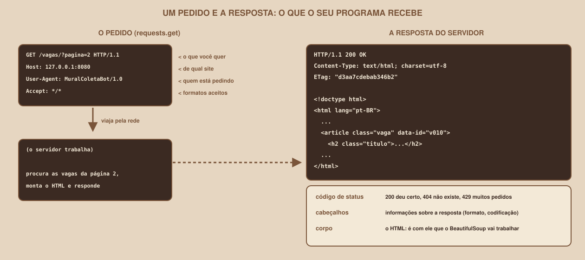
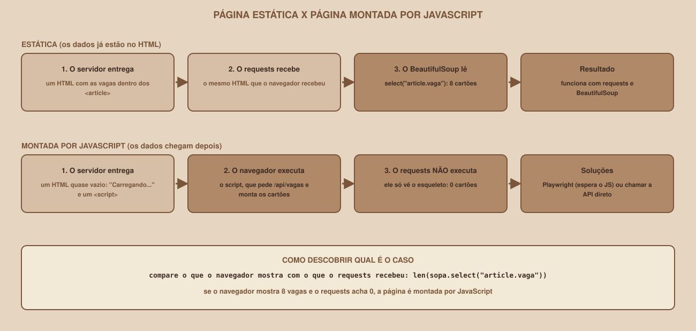

# Módulo 01, Como a Web Entrega Páginas

Português · [English](../docs-eng/01-how-the-web-delivers-pages.md)

`SEM 07 // Data & Scraping, Parte 1: Coleta`

---

## // Antes de começar

Para coletar dados de uma página, você precisa entender **o que o seu programa recebe** quando pede essa página. Este módulo não exige nada de módulos anteriores: ele explica, do zero, a conversa entre um programa e um site, e o que muda quando a página é montada por JavaScript.

## // Um pedido e uma resposta

Toda página que você abre é o resultado de uma conversa curta entre dois lados: o **cliente** (o navegador, ou o seu programa) e o **servidor** (o computador que guarda o site). O cliente faz um **pedido**, o servidor devolve uma **resposta**, e a conversa acaba.

<div align="center">

</div>

O protocolo dessa conversa se chama **HTTP**. O pedido tem uma primeira linha com o **método** (quase sempre `GET`, que significa "me dê isto") e o **caminho**, e vem seguido de **cabeçalhos**, que são informações sobre quem pede. A resposta tem um **código de status**, os seus próprios cabeçalhos e o **corpo**: o HTML da página. É o corpo que o BeautifulSoup vai ler.

## // O endereço (URL)

Um endereço como `http://127.0.0.1:8080/vagas/?pagina=2` tem partes, e cada uma importa para quem coleta:

| Parte | No exemplo | Para que serve |
|---|---|---|
| Esquema | `http` | O protocolo (`https` é o mesmo, com criptografia) |
| Servidor (host) | `127.0.0.1` | Quem responde. `127.0.0.1` é o **seu próprio computador** |
| Porta | `8080` | A "porta" do servidor. Sem ela, vale a padrão (80 para `http`, 443 para `https`) |
| Caminho | `/vagas/` | Qual página ou recurso você quer |
| Consulta | `?pagina=2` | Parâmetros, no formato `nome=valor`. Vários vêm separados por `&` |
| Fragmento | `#candidatar` | Um ponto dentro da página. **Nunca é enviado ao servidor** |

A consulta é a sua aliada na paginação: `?pagina=1`, `?pagina=2`... É por ela que se pede cada página de uma lista.

## // Os códigos de status

O primeiro dado de uma resposta é o código de status, um número de três dígitos. A primeira casa diz a família:

| Família | Significa | Exemplos que você vai encontrar nesta semana |
|---|---|---|
| `2xx` | Deu certo | `200` OK |
| `3xx` | Vá para outro lugar, ou nada mudou | `301` mudou de endereço, `304` não mudou |
| `4xx` | O **pedido** tem um problema | `404` não existe, `403` acesso negado, `429` pedidos demais |
| `5xx` | O **servidor** tem um problema | `500` erro interno, `503` indisponível agora |

O Mural Tech, o site de treino, produz cada um deles de propósito, e você verá todos nos módulos seguintes. Os que valem decorar já: nas páginas que você coleta com `GET`, `200` OK é a resposta de sucesso esperada (existem outros códigos `2xx`, como `201` e `206`, para outros tipos de resposta); `404` e `403` não adianta repetir; `429` e `503` significam "espere um pouco e tente de novo", e é obrigação de um bom scraper atender.

## // Os cabeçalhos que importam

Esta é uma resposta real do Mural Tech, obtida com o comando `curl -s -D - -o /dev/null http://127.0.0.1:8080/vagas/` (que mostra só os cabeçalhos):

```
HTTP/1.0 200 OK
Server: BaseHTTP/0.6 Python/3.12.3
Date: (data e hora)
Content-Type: text/html; charset=utf-8
Content-Length: 4122
ETag: "d3aa7cdebab346b2"
```

| Cabeçalho | O que diz | Por que importa para quem coleta |
|---|---|---|
| `Content-Type` | O formato e a **codificação** do corpo | Sem o `charset`, os acentos podem sair errados (Módulo 05) |
| `Content-Length` | O tamanho do corpo, em bytes | Dá ideia do peso de cada página |
| `ETag` | Uma "impressão digital" desta versão da página | Permite perguntar "mudou?" sem baixar de novo (Módulo 11) |
| `Retry-After` | Quantos segundos esperar | Aparece junto de `429` e `503`: obedeça (Módulo 11) |
| `Location` | Para onde ir | Aparece junto de `301` |

E há um cabeçalho **seu**, que você manda em todo pedido: o `User-Agent`, que diz quem está pedindo. O navegador manda o dele. O `requests`, se você não disser nada, manda `python-requests/2.34.2`. Um bom scraper se identifica de verdade (Módulo 03).

## // Página estática e página montada por JavaScript

Esta é a distinção mais importante do módulo, porque decide **qual ferramenta** você vai usar.

<div align="center">

</div>

Em uma página **estática**, os dados já estão no HTML que o servidor entrega. Este é um trecho real do corpo de `/vagas/`:

```html
<article class="vaga" data-id="v002">
  <h2 class="titulo"><a href="/vagas/v002">Analista de Dados Pleno</a></h2>
  <p class="empresa">Pinhão Dados</p>
  ...
</article>
```

Em uma página **montada por JavaScript**, o servidor entrega só um esqueleto, e o navegador executa um programa (o `<script>`) que busca os dados e preenche a página. Este é o HTML real de `/vagas-js/`, exatamente como o seu programa o recebe:

```html
<main>
<h1>Vagas de tecnologia</h1>
<div id="resultado">Carregando...</div>
<script>
async function carregar() {
  await new Promise((r) => setTimeout(r, 400));
  const resp = await fetch("/api/vagas?pagina=1&por_pagina=8");
  const dados = await resp.json();
  const alvo = document.getElementById("resultado");
  ...
```

Quem abre `/vagas-js/` no navegador vê as vagas depois de menos de um segundo. Quem a baixa com o `requests` vê **"Carregando..."** e **nenhum cartão**: o `requests` entrega o HTML, mas **não executa o JavaScript**. Rodando o script real contra a página:

```
status: 200
cartões na página: 0
texto do #resultado: Carregando...
há um <script> no HTML? True
```

Para páginas assim há dois caminhos, e o Módulo 16 mostra os dois: usar um navegador de verdade, controlado por código (Playwright), ou descobrir **a API que a página usa** (no exemplo, `/api/vagas`) e chamá-la direto.

> **COMO SABER QUAL É O CASO**
> Compare o que o navegador mostra com o que o `requests` recebeu. Uma conta resolve: `len(sopa.select("article.vaga"))`. Se o navegador mostra 8 vagas e a conta dá 0, a página é montada por JavaScript. Outra pista: no navegador, o atalho **Ctrl+U** abre o HTML original (o que o servidor entregou), e a ferramenta **Inspecionar** mostra a página já montada. A interface dessas ferramentas não foi conferida na produção deste material, e os nomes variam entre navegadores.

## // O Mural Tech, o site de treino

Em um terminal, dentro da pasta `site-treino`, ligue o site:

```
python3 servidor.py
```

```
Mural Tech no ar em http://127.0.0.1:8080  (dia 1). Ctrl+C para parar.
```

Deixe esse terminal aberto: o site só existe enquanto o programa roda. Estas são as páginas dele, e cada uma existe por um motivo:

| Endereço | O que tem | Usada no módulo |
|---|---|---|
| `/vagas/` e `/vagas/?pagina=2` | A lista de vagas, em 3 páginas | 06, 07 |
| `/vagas/v003` | O detalhe de uma vaga | 02, 07 |
| `/eventos/` | A lista de eventos | 09 |
| `/robots.txt` | As regras para robôs | 03 |
| `/vagas-js/` e `/api/vagas` | Vagas montadas por JavaScript, e a API que as entrega | 16, 17 |
| `/quebrado/` | HTML mal escrito | 06 |
| `/legado/vagas` | Uma página sem a codificação declarada | 05 |
| `/lento` | Uma resposta que demora 3 segundos | 05 |
| `/instavel/vagas` e `/limitado/vagas` | Falhas `503` e limite de pedidos `429` | 11 |
| `/eco` e `/antigo/vagas` | Devolve seus cabeçalhos, e um redirecionamento `301` | 05 |
| `/_dev/...` | Controles do treino: trocar o "dia" dos dados, ligar atraso | 10, 12, 15 |

O site tem também um **"dia 2"**: depois de `/_dev/dia/2`, algumas vagas são novas, dois salários mudam e uma vaga some. É assim que o pipeline vai aprender a atualizar o banco, em vez de apenas encher.

## // Bom exemplo × mau exemplo

**Mau exemplo**: tratar toda resposta como se fosse boa, sem olhar o status:

```python
html = requests.get(url).text
```

Se a página não existir (`404`) ou o servidor estiver pedindo calma (`429`), o texto da página de erro será lido como se fosse uma vaga, e o erro só aparecerá lá na frente, no banco.

**Bom exemplo**: olhar o status antes de ler, e dar um tempo limite ao pedido:

```python
resposta = requests.get(url, timeout=10)
resposta.raise_for_status()
```

O Módulo 05 explica cada uma dessas duas linhas.

## // Erros comuns

| Erro | Por que acontece | Como corrigir |
|---|---|---|
| `ConnectionError: ... Connection refused` | O site de treino não está ligado (mensagem obtida no Linux; outros sistemas escrevem de outro jeito) | Ligue o `servidor.py` e deixe o terminal aberto |
| 0 cartões em uma página que mostra vagas no navegador | A página é montada por JavaScript | Compare com `Ctrl+U`; use o Módulo 16 |
| `404` em um endereço que parece certo | Falta a barra final, ou um erro de digitação | Confira o caminho exato, e copie-o do navegador |
| O que você vê no navegador difere do que o programa recebe | O navegador executou JavaScript, ou mandou outros cabeçalhos | Baixe a página e leia o HTML cru |

## // Prática guiada

1. Ligue o Mural Tech e abra `http://127.0.0.1:8080/vagas/` no navegador.
2. Abra o código-fonte da página (`Ctrl+U`) e encontre um `<article class="vaga">`.
3. Abra `http://127.0.0.1:8080/vagas-js/`, espere o conteúdo aparecer, e abra o código-fonte dela. Compare: o que aparece na tela **não está** no código-fonte.
4. Abra `http://127.0.0.1:8080/api/vagas?pagina=1&por_pagina=3` e leia o JSON: é a fonte de dados da página anterior.
5. Em outro terminal, rode `curl -s -D - -o /dev/null http://127.0.0.1:8080/vagas/` e identifique o `Content-Type` e a `ETag`.

## // Pratique sozinho

> **DESAFIO**
> Escreva um script que peça, **sem seguir redirecionamentos**, os endereços `/vagas/`, `/vagas/v999` e `/antigo/vagas`, e imprima o código de status e o `Content-Type` de cada um. Use `requests.get(url, allow_redirects=False, timeout=10)`. Resultado esperado: `200`, `404` e `301`.

## // Aplicando no projeto da semana

1. Crie a pasta `projeto-coleta/` no seu computador. Ela vai crescer a cada módulo, até virar o pipeline.
2. Copie para dentro dela a pasta `site-treino/` deste material.
3. Crie o arquivo `anotacoes.md` e escreva, com as suas palavras, a diferença entre uma página estática e uma montada por JavaScript. Você vai relê-lo no Módulo 16.

## // Checkpoint

> **ANTES DE SEGUIR, PENSE NISTO**
> O seu scraper baixa `/vagas-js/` e encontra 0 vagas, sem nenhum erro. O servidor respondeu `200`. Por que o programa não deu erro, e o que isso ensina sobre como conferir o seu trabalho?

Resposta: porque, para o `requests`, tudo correu bem: ele pediu uma página, recebeu uma página, e a página (o esqueleto) não tem erro nenhum. Quem está errado é a **expectativa** de que o HTML tivesse as vagas. Um `200` diz que a resposta chegou, e não que os dados estão nela. Por isso um scraper bem feito **confere o resultado** (quantas vagas vieram? quantos campos estão vazios?), em vez de confiar só na ausência de erros. O Módulo 11 transforma essa conferência em alarme.

## // Resumo do módulo

- [ ] Sei descrever um pedido e uma resposta HTTP.
- [ ] Sei identificar as partes de uma URL, e para que serve a consulta (`?pagina=2`).
- [ ] Sei as quatro famílias de códigos de status, e quais pedem para esperar.
- [ ] Sei que o `Content-Type` carrega a codificação, e que o `ETag` e o `Retry-After` existem.
- [ ] Sei a diferença entre uma página estática e uma montada por JavaScript.
- [ ] Sei ligar o Mural Tech e dizer para que serve cada página dele.

---

**Próximo módulo:** `02-html-para-quem-vai-extrair.md`, você já sabe como a página chega. Agora, como ler o que está dentro dela.

`Material de Estudo // Coffee & Code`
