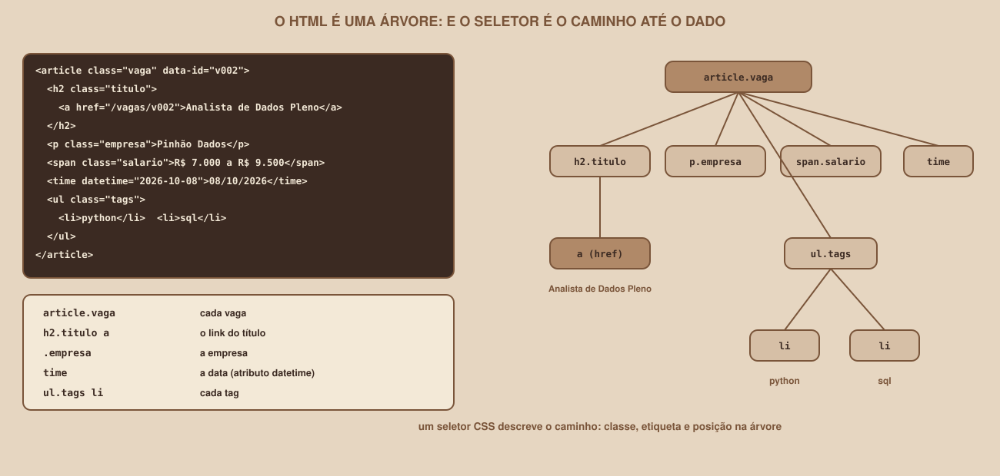

# Módulo 02, HTML para Quem Vai Extrair

Português · [English](../docs-eng/02-html-for-those-who-will-extract.md)

`SEM 07 // Data & Scraping, Parte 1: Coleta`

---

## // Antes de começar

Para extrair um dado de uma página, é preciso saber **onde ele está**. Este módulo ensina a ler HTML do ponto de vista de quem vai coletar: sem tentar aprender a construir sites, apenas a reconhecer as peças e a escolher as mais confiáveis. Não exige nenhum conhecimento prévio de HTML.

## // O que é HTML

> **HTML: EM PALAVRAS SIMPLES**
> É um texto com **marcas** que dizem o que cada pedaço é: um título, um parágrafo, um link, uma lista. O navegador lê as marcas e desenha a página. Você, com o BeautifulSoup, vai ler as mesmas marcas para encontrar os dados.

As marcas se chamam **tags**, e aparecem em pares, uma de abertura e uma de fechamento. Este é um cartão de vaga real do Mural Tech:

```html
<article class="vaga" data-id="v002">
  <h2 class="titulo"><a href="/vagas/v002">Analista de Dados Pleno</a></h2>
  <p class="empresa">Pinhão Dados</p>
  <p class="local">Remoto</p>
  <span class="modalidade">Remoto</span>
  <span class="nivel">Pleno</span>
  <span class="salario">R$ 7.000 a R$ 9.500</span>
  <time datetime="2026-10-08">08/10/2026</time>
  <ul class="tags">
    <li>python</li><li>pandas</li><li>sql</li><li>power bi</li></ul>
</article>
```

(O HTML real escreve a lista de tags em uma linha só, e foi quebrada aqui para caber na página.)

Leia assim: `<p class="empresa">Pinhão Dados</p>` é um **parágrafo** (`p`) que tem um **atributo** (`class`) com o valor `empresa`, e cujo **conteúdo** é o texto `Pinhão Dados`. Os atributos ficam dentro da tag de abertura, no formato `nome="valor"`.

## // A árvore

As tags se **aninham**: o `<h2>` está dentro do `<article>`, e o `<a>` está dentro do `<h2>`. Por isso se diz que o HTML forma uma **árvore**, e usamos as palavras da família para descrevê-la: o `article` é o **pai** do `h2`; o `h2` e o `p` são **irmãos**; o `a` é **filho** do `h2` e **descendente** do `article`.

<div align="center">

</div>

Essa ideia é a base de tudo: **extrair é escolher um caminho na árvore**. No Módulo 06, você escreverá esses caminhos como seletores.

## // As peças que mais aparecem

| Tag | O que é | Onde aparece no Mural Tech |
|---|---|---|
| `h1`, `h2`, `h3` | Títulos, do maior ao menor | O título da página, da vaga, do evento |
| `p` | Um parágrafo | Empresa, local, descrição |
| `span` | Um trecho de texto, sem significado próprio | Modalidade, nível, salário |
| `a` | Um link. O destino está no atributo `href` | O título da vaga leva ao detalhe |
| `ul` e `li` | Uma lista e seus itens | As tags da vaga, os requisitos |
| `time` | Uma data. O valor para máquina está em `datetime` | A data de publicação |
| `article` | Um bloco independente | Cada cartão de vaga |
| `div` | Um bloco genérico, sem significado | A descrição da vaga |

## // Os atributos que valem ouro

Para quem coleta, três atributos têm importância especial:

- **O atributo class**: dá um nome ao elemento. Um elemento pode ter várias classes (`class="vaga destaque"`). É o gancho mais comum dos seletores.
- **O atributo id**: um nome **único** na página (`<div id="resultado">`).
- **Os atributos data-**: atributos feitos para guardar dados. Repare no `data-id="v002"` do cartão: é o **identificador da vaga no site**, e vai servir para reconhecer a mesma vaga em coletas diferentes (Módulo 10).

E dois atributos guardam o dado **já limpo**, e vale preferi-los ao texto exibido:

| Atributo | No exemplo | Por que é melhor que o texto |
|---|---|---|
| `datetime` do `time` | `2026-10-08` | O texto exibido (`08/10/2026`) muda com o idioma; o atributo é padronizado |
| `href` do `a` | `/vagas/v002` | É o endereço de verdade, que você vai visitar |

## // O detalhe de uma vaga

A página de detalhe (`/vagas/v003`) usa as mesmas ideias, com mais informação. Este é um trecho real:

```html
<article class="vaga-detalhe" data-id="v003">
<h1 class="titulo">Engenheiro(a) de Software Sênior</h1>
<p class="empresa">Araucária Labs</p>
<p class="local">Curitiba, PR (Presencial)</p>
<p class="salario">R$ 14.000 a R$ 18.000</p>
<time datetime="2026-10-07">Publicada em 07/10/2026</time>
<div class="descricao"><p>A Araucária Labs procura uma pessoa para ...</p></div>
<h2>Requisitos</h2>
<ul class="requisitos"><li>Experiência com java</li>...</ul>
</article>
```

Repare que o mesmo dado pode ter **formatos diferentes** em páginas diferentes: na lista, o local é `Curitiba, PR`, e no detalhe é `Curitiba, PR (Presencial)`. Esse é o tipo de diferença que a limpeza (Módulo 08) vai absorver.

## // Escolhendo o que extrair

Antes de escrever código, faça um **plano de campos**: para cada dado que você quer, anote onde ele está. Este é o plano da lista de vagas:

| Campo | Onde está | Seletor (Módulo 06) | Exemplo |
|---|---|---|---|
| id da vaga | atributo `data-id` do `article` | `article.vaga` | `v002` |
| título | texto do link dentro do `h2` | `h2.titulo a` | `Analista de Dados Pleno` |
| empresa | texto do `p` | `.empresa` | `Pinhão Dados` |
| salário | texto do `span` | `.salario` | `R$ 7.000 a R$ 9.500` |
| data | atributo `datetime` | `time` | `2026-10-08` |
| tags | texto de cada `li` | `ul.tags li` | `python`, `pandas`... |
| link do detalhe | atributo `href` | `h2.titulo a` | `/vagas/v002` |

## // Bom exemplo × mau exemplo

**Mau exemplo**: apontar para a **posição** do elemento. Um seletor como "o terceiro `span` do segundo `div`" quebra no dia em que o site acrescentar qualquer elemento antes dele.

**Bom exemplo**: apontar para o **significado**. A classe `.salario` diz o que o elemento **é**, e continua valendo mesmo que o site reorganize o resto da página. Prefira sempre, nesta ordem: um atributo de dado (`data-id`), uma classe com significado (`.salario`), e só em último caso a posição.

## // Erros comuns

| Erro | Por que acontece | Como corrigir |
|---|---|---|
| Procurar no código um texto que está na tela, e não achá-lo | A página é montada por JavaScript | Veja o Módulo 01 |
| Um acento ou símbolo estranho no texto (`&amp;`, `&lt;`) | O HTML escreve certos símbolos como "entidades" | O BeautifulSoup converte sozinho: `Cafe &amp; C&oacute;digo` vira `Cafe & Código` |
| Confundir `class` e `id` | `class` pode se repetir, e `id` é único | Para listas de itens, use classes |
| Esperar que o texto venha limpo | O HTML guarda espaços e quebras de linha | Use `get_text(strip=True)` (Módulo 06) |

## // Prática guiada

1. Com o Mural Tech ligado, abra `/vagas/` no navegador e use `Ctrl+U` para ver o código-fonte.
2. Procure o primeiro `<article class="vaga">` e leia o HTML dele, campo a campo, ao lado da tela.
3. Abra `/vagas/v003` e faça o mesmo.
4. Salve uma página para estudar com calma: `curl -s http://127.0.0.1:8080/vagas/ -o vagas.html`, e abra o `vagas.html` no seu editor.

## // Pratique sozinho

> **DESAFIO**
> Monte o plano de campos da **página de detalhe** de uma vaga (`/vagas/v003`), no mesmo formato da tabela acima. Quais campos o detalhe tem que a lista **não** tem? Dica: compare o cartão da lista com o `article.vaga-detalhe`. Resposta: a **descrição** (`.descricao`) e os **requisitos** (`ul.requisitos li`).

## // Aplicando no projeto da semana

1. No `anotacoes.md`, cole o plano de campos da lista de vagas e o do detalhe.
2. Acrescente uma coluna "o que pode faltar": por exemplo, o salário pode vir como `A combinar`. Você vai tratar isso no Módulo 08.

## // Checkpoint

> **ANTES DE SEGUIR, PENSE NISTO**
> Dois seletores acham o título de uma vaga: `h2.titulo a` e "o primeiro link da página dentro do terceiro bloco". Qual é melhor, e o que acontece com cada um se o site acrescentar um banner no topo da página?

Resposta: `h2.titulo a`, porque aponta para o **significado**. O banner novo desloca a posição de tudo, e o seletor por posição passa a apontar para o elemento errado (ou para nada), sem avisar. O seletor por classe continua achando o título, porque o banner não mudou o que é um título.

## // Resumo do módulo

- [ ] Sei ler uma tag, um atributo e o conteúdo de um elemento.
- [ ] Sei descrever a árvore com pai, filho e irmão.
- [ ] Sei para que servem `class`, `id` e `data-*`.
- [ ] Sei que `datetime` e `href` guardam o dado limpo.
- [ ] Sei fazer um plano de campos antes de escrever código.
- [ ] Sei preferir seletores por significado, e não por posição.

---

**Próximo módulo:** `03-etica-termos-e-robots-txt.md`, você já sabe ler uma página. Antes de coletar de verdade, vem a pergunta mais importante: pode?

`Material de Estudo // Coffee & Code`
