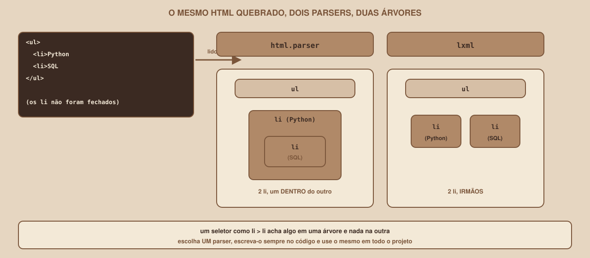

# Módulo 06, BeautifulSoup: Lendo o HTML

Português · [English](../docs-eng/06-beautifulsoup-reading-the-html.md)

`SEM 07 // Data & Scraping, Parte 1: Coleta`

---

## // Antes de começar

No Módulo 05 você baixou uma página com o `requests` e guardou o HTML em uma variável. Esse HTML é, para o Python, **um texto comprido e sem estrutura**. Este módulo apresenta a ferramenta que transforma esse texto em algo que se pode navegar e consultar: o **BeautifulSoup**. É o módulo central da semana, porque é aqui que uma página vira dados.

Todos os exemplos usam o Mural Tech, o site de treino. Ligue-o em um terminal (`python3 servidor.py`, dentro da pasta `site-treino`) e deixe-o rodando.

## // O problema: HTML é texto, e texto não tem estrutura

Qual é o jeito mais óbvio de pegar o título de uma vaga? Procurar, no texto, o que está entre `<h2>` e `</h2>`. Veja o que acontece, em uma execução real contra a página de vagas:

```python
import re

import requests

BASE = "http://127.0.0.1:8080"
html = requests.get(f"{BASE}/vagas/", timeout=10).text

# Tentativa 1: procurar <h2>título</h2>
achados = re.findall(r"<h2>(.*?)</h2>", html)
print("regex <h2>...</h2> achou:", len(achados))

# Tentativa 2: aceitar o atributo class, mas o título está dentro de um <a>
achados = re.findall(r'<h2 class="titulo">(.*?)</h2>', html)
print("regex com class achou:", len(achados))
print("primeiro resultado:", achados[0])
```

```
regex <h2>...</h2> achou: 0
regex com class achou: 8
primeiro resultado: <a href="/vagas/v002">Analista de Dados Pleno</a>
```

A primeira tentativa achou **zero** títulos, porque o `<h2>` real tem um atributo (`class="titulo"`). A segunda achou oito, mas devolveu **o HTML do link**, e não o título. E qualquer mudança pequena do site (uma aspa simples no lugar da dupla, um atributo a mais, uma quebra de linha) quebraria a expressão de novo. Expressões regulares enxergam **caracteres**. O que você quer enxergar são **elementos**.

## // O que é o BeautifulSoup

> **BEAUTIFULSOUP: EM PALAVRAS SIMPLES**
> É uma biblioteca do Python que lê um texto HTML e o transforma em uma **árvore de objetos**, que você consulta pelo nome da tag, pela classe ou por um seletor CSS. Ela também lida com HTML mal escrito, que é comum na web real.

Instale-a, junto com o `lxml` (um leitor de HTML rápido, que o BeautifulSoup pode usar), dentro do ambiente virtual do Módulo 04:

```
pip install beautifulsoup4 lxml
```

O nome do pacote é `beautifulsoup4`, mas a importação é `from bs4 import BeautifulSoup`. Este material foi verificado com a versão 4.15.0, e a sua documentação foi consultada em 09/10/2026.

## // A primeira sopa

O nome "sopa" vem da gíria para HTML bagunçado. Você cria a sopa passando o conteúdo da página e o nome do leitor (o *parser*):

```python
import requests
from bs4 import BeautifulSoup

BASE = "http://127.0.0.1:8080"
resposta = requests.get(f"{BASE}/vagas/", timeout=10)
resposta.raise_for_status()

sopa = BeautifulSoup(resposta.content, "lxml")
print("tipo:", type(sopa).__name__)
print("título da página:", sopa.title.get_text())
print("h1:", sopa.h1.get_text())

cartoes = sopa.find_all("article", class_="vaga")
print("cartões:", len(cartoes), "| tipo:", type(cartoes).__name__)

primeiro = cartoes[0]
print("id:", primeiro["data-id"])
print("título:", primeiro.h2.get_text(strip=True))
print("empresa:", primeiro.find("p", class_="empresa").get_text(strip=True))

link = primeiro.find("a")
print("link:", link["href"])
print("atributos do link:", link.attrs)

hora = primeiro.find("time")
print("datetime:", hora["datetime"], "| texto:", hora.get_text())
print("classes:", primeiro["class"])
print("atributo que não existe, com .get:", primeiro.get("data-xyz"))
print("com valor padrão:", primeiro.get("data-xyz", "padrão"))
```

```
tipo: BeautifulSoup
título da página: Vagas | Mural Tech
h1: Vagas de tecnologia
cartões: 8 | tipo: ResultSet
id: v002
título: Analista de Dados Pleno
empresa: Pinhão Dados
link: /vagas/v002
atributos do link: {'href': '/vagas/v002'}
datetime: 2026-10-08 | texto: 08/10/2026
classes: ['vaga']
atributo que não existe, com .get: None
com valor padrão: padrão
```

Repare em duas coisas no código: usamos `resposta.content` (os **bytes** da resposta), e não `resposta.text`. Deixar o BeautifulSoup decidir a codificação a partir dos bytes evita erros de acento (veja a seção sobre erros comuns). E o `raise_for_status()` garante que uma página de erro não seja lida como se fosse uma página de vagas.

| Você escreve | O que significa |
|---|---|
| `sopa.title`, `sopa.h1` | A **primeira** tag desse nome na página |
| `find("p", class_="empresa")` | A primeira tag `p` com a classe `empresa`, ou `None` |
| `find_all("article", class_="vaga")` | **Todas** as tags `article` com a classe `vaga`, em uma lista (`ResultSet`) |
| `tag["href"]` | O valor de um atributo. Dá erro se o atributo não existir |
| `tag.get("data-xyz")` | O valor de um atributo, ou `None` (ou o padrão que você der) |
| `tag.attrs` | Todos os atributos, em um dicionário |
| `tag.get_text(strip=True)` | O texto de dentro da tag, sem espaços nas pontas |

> **POR QUE class_ E NÃO class?**
> Em Python, `class` é uma palavra reservada (a que cria classes). Escrever `find_all("article", class="vaga")` é um erro de sintaxe (`SyntaxError: invalid syntax`). O BeautifulSoup resolve com `class_`, com um sublinhado no fim. Os atributos com várias classes (`class="vaga destaque"`) voltam como uma **lista**: `['vaga']`.

## // A árvore e os seletores

<div align="center">

</div>

O desenho mostra o HTML de um cartão e a **árvore** que o BeautifulSoup monta: um `article` com filhos (`h2`, `p`, `span`, `time` e `ul`), e os `h2` e `ul` com filhos próprios. Navegar é escolher o caminho até o dado.

Um jeito mais poderoso e mais curto de escolher o caminho é o **seletor CSS**, a mesma linguagem que as folhas de estilo usam. O BeautifulSoup oferece dois métodos:

| Método | Devolve |
|---|---|
| `select("seletor")` | **Todas** as tags que casam, em uma lista (vazia se nenhuma casar) |
| `select_one("seletor")` | A **primeira** tag que casa, ou `None` |

| Seletor | O que escolhe | Exemplo nesta página |
|---|---|---|
| `article` | Toda tag `article` | Os cartões |
| `.vaga` | Todo elemento com a classe `vaga` | Os cartões |
| `article.vaga` | `article` **com** a classe `vaga` | Os cartões |
| `h2.titulo a` | Um `a` **dentro** de um `h2.titulo` (em qualquer nível) | O link do título |
| `ul.tags li` | Cada `li` dentro de `ul.tags` | As tags da vaga |
| `a[rel=next]` | Um `a` com o atributo `rel` igual a `next` | O link "Próxima" |

Aqui está o script que extrai todos os cartões da página, usando seletores:

```python
import requests
from bs4 import BeautifulSoup

BASE = "http://127.0.0.1:8080"


def texto(tag):
    """O texto limpo de uma tag, ou None se a tag não existe."""
    return tag.get_text(strip=True) if tag is not None else None


def ler_cartao(cartao):
    return {
        "id": cartao["data-id"],
        "titulo": texto(cartao.select_one("h2.titulo a")),
        "empresa": texto(cartao.select_one(".empresa")),
        "local": texto(cartao.select_one(".local")),
        "salario": texto(cartao.select_one(".salario")),
        "publicada": cartao.select_one("time")["datetime"],
        "tags": [li.get_text(strip=True) for li in cartao.select("ul.tags li")],
        "link": cartao.select_one("h2.titulo a")["href"],
    }


resposta = requests.get(f"{BASE}/vagas/", timeout=10)
resposta.raise_for_status()
sopa = BeautifulSoup(resposta.content, "lxml")

vagas = [ler_cartao(c) for c in sopa.select("article.vaga")]
print("vagas extraídas:", len(vagas))
for v in vagas[:3]:
    print(v)

print("só os títulos:", [v["titulo"] for v in vagas[:3]])
print("com 'python' nas tags:", [v["id"] for v in vagas if "python" in v["tags"]])
```

```
vagas extraídas: 8
{'id': 'v002', 'titulo': 'Analista de Dados Pleno', 'empresa': 'Pinhão Dados',
 'local': 'Remoto', 'salario': 'R$ 7.000 a R$ 9.500', 'publicada': '2026-10-08',
 'tags': ['python', 'pandas', 'sql', 'power bi'], 'link': '/vagas/v002'}
só os títulos: ['Analista de Dados Pleno', 'Desenvolvedor(a) Python Júnior',
 'Estágio em Desenvolvimento Web']
com 'python' nas tags: ['v002', 'v001', 'v008', 'v007']
```

(A saída real escreve cada dicionário em uma única linha, e foi quebrada aqui para caber na página. Os outros dois dicionários foram omitidos.)

Duas decisões desse código valem ouro. A primeira é o **dicionário**: cada vaga vira um dicionário com os mesmos campos, o formato que o banco de dados vai receber no Módulo 10. A segunda é a função `texto()`, explicada a seguir.

> **FIND OU SELECT?**
> Os dois fazem o mesmo trabalho. Os seletores CSS (`select`) costumam ser mais curtos e são os mesmos que você usa no navegador ao inspecionar uma página, por isso este material os prefere. O `find` e o `find_all` são úteis para buscas simples, como `sopa.find("h1")`.

## // O leitor (parser): a escolha que muda o resultado

Quando o HTML está bem escrito, qualquer leitor devolve a mesma árvore. Mas a web real está cheia de HTML quebrado: tags que nunca foram fechadas, atributos sem aspas. Segundo a documentação, quando o documento é inválido, **leitores diferentes montam árvores diferentes**.

<div align="center">

</div>

O Mural Tech tem uma página propositalmente quebrada (`/quebrado/`), com `<li>` e `<p>` sem fechar. Este script a lê com os dois leitores:

```python
import requests
from bs4 import BeautifulSoup

BASE = "http://127.0.0.1:8080"
bruto = requests.get(f"{BASE}/quebrado/", timeout=10).content

for parser in ("html.parser", "lxml"):
    sopa = BeautifulSoup(bruto, parser)
    print(f"--- {parser}")
    print("itens da lista (li):", len(sopa.find_all("li")))
    primeiro_li = sopa.find("li")
    print("o primeiro li contém outro li?", primeiro_li.find("li") is not None)
    print("parágrafos (p):", len(sopa.find_all("p")))
    print(str(sopa.body)[:140].replace("\n", " "))
```

```
--- html.parser
itens da lista (li): 2
o primeiro li contém outro li? True
parágrafos (p): 3
<body><ul class="tags"><li>Python<li>SQL</li></li></ul> <p>um<p>dois ...
--- lxml
itens da lista (li): 2
o primeiro li contém outro li? False
parágrafos (p): 3
<body><ul class="tags"><li>Python</li><li>SQL</li></ul> <p>um</p><p>dois ...
```

(A última linha de cada leitor foi cortada aqui; a saída real continua com o restante do `<body>`.)

O HTML era o mesmo, e os dois leitores concordaram na **contagem** (2 itens, 3 parágrafos), mas discordaram na **estrutura**: o `html.parser` colocou um `<li>` **dentro** do outro, e o `lxml` os deixou **irmãos**. Um seletor como `ul.tags > li` acharia os dois itens em uma árvore, e só um na outra.

| | `html.parser` | `lxml` |
|---|---|---|
| Instalação | Já vem com o Python | `pip install lxml` |
| Velocidade | Mais lento | Mais rápido |
| HTML quebrado | Segue as tags literalmente | Reconstrói o HTML malformado segundo as regras do próprio parser |

> **REGRA: ESCREVA O LEITOR, E USE O MESMO SEMPRE**
> Passe sempre o nome do leitor (`"lxml"` ou `"html.parser"`) e use o **mesmo** em todo o projeto. Sem ele, o BeautifulSoup escolhe um leitor por conta própria, e o resultado pode variar de uma máquina para outra. Este material usa `"lxml"`.

Se você pedir um leitor que não existe, ou que não está instalado, o erro é claro:

```
FeatureNotFound: Couldn't find a tree builder with the features you requested:
naoexiste. Do you need to install a parser library?
```

## // Quando o elemento não existe

Este é o erro mais comum de quem começa. Nem toda vaga tem salário publicado, e uma página pode mudar. O que acontece quando o seletor não acha nada? Este script reproduz o problema com um cartão sem o campo de salário:

```python
from urllib.parse import urljoin

from bs4 import BeautifulSoup

HTML = """
<article class="vaga" data-id="x1">
  <h2 class="titulo"><a href="/vagas/x1">Vaga sem salário</a></h2>
  <p class="empresa">Empresa Fictícia</p>
</article>
"""
sopa = BeautifulSoup(HTML, "lxml")
cartao = sopa.select_one("article.vaga")

salario = cartao.select_one(".salario")
print("select_one de algo que não existe:", salario)
print("find com classe errada:", cartao.find("p", class_="nao-existe"))
print("find_all de algo que não existe:", cartao.find_all("span"))

try:
    cartao.select_one(".salario").get_text()
except AttributeError as erro:
    print("AttributeError:", erro)
```

```
select_one de algo que não existe: None
find com classe errada: None
find_all de algo que não existe: []
AttributeError: 'NoneType' object has no attribute 'get_text'
```

A regra: `select_one` e `find` devolvem `None` quando não acham nada, e `select` e `find_all` devolvem uma **lista vazia**. Pedir `.get_text()` de um `None` quebra o programa com `AttributeError`. Por isso o script do começo do módulo usa a função `texto()`, que devolve `None` quando a tag não existe, em vez de quebrar:

```python
def texto(tag):
    """O texto limpo de uma tag, ou None se a tag não existe."""
    return tag.get_text(strip=True) if tag is not None else None
```

Com ela, uma vaga sem salário vira `{"salario": None}`, e o scraper segue em frente. Um campo ausente é uma **informação** (a vaga não publicou o salário), e não um motivo para o programa parar.

## // Links relativos

O `href` da vaga é `/vagas/v002`, um endereço **relativo**: não tem o `http://` nem o servidor. Para baixar a página de detalhe, você precisa do endereço completo, e a biblioteca padrão resolve isso com o `urljoin`:

```python
link = cartao.select_one("h2 a")["href"]
print("link relativo:", link)
print("link absoluto:", urljoin("http://127.0.0.1:8080/vagas/", link))
print("paginação relativa:", urljoin("http://127.0.0.1:8080/vagas/", "?pagina=2"))
```

```
link relativo: /vagas/x1
link absoluto: http://127.0.0.1:8080/vagas/x1
paginação relativa: http://127.0.0.1:8080/vagas/?pagina=2
```

## // Espiando a árvore

Quando um seletor não acha o que você espera, a primeira coisa a fazer é **olhar**. O método `prettify()` reescreve a árvore com recuos, e mostra exatamente o que o BeautifulSoup enxergou:

```python
print(cartao.prettify())
```

```
<article class="vaga" data-id="x1">
 <h2 class="titulo">
  <a href="/vagas/x1">
   Vaga sem salário
  </a>
 </h2>
 <p class="empresa">
  Empresa Fictícia
 </p>
</article>
```

Outro hábito útil é contar: `len(sopa.select("article.vaga"))` deve dar 8 nesta página. Se der 0, o seletor está errado, a página não é a que você imaginava, ou o HTML que o `requests` recebeu **não é o mesmo que o navegador mostra** (páginas montadas por JavaScript, assunto dos Módulos 01 e 16).

## // Bom exemplo × mau exemplo

**Mau exemplo**: confiar que o elemento sempre existe, e juntar o texto sem limpar:

```python
salario = cartao.select_one(".salario").get_text()
```

Em uma vaga sem salário, o programa quebra com `AttributeError`. E, sem `strip=True`, o texto pode vir com quebras de linha e espaços (o `get_text()` do cartão inteiro, sem limpeza, começa com `'\nAnalista de Dados Pleno\nPinhão Dados\n...'`).

**Bom exemplo**: tratar a ausência, e limpar o texto:

```python
salario = texto(cartao.select_one(".salario"))
```

## // Erros comuns

Estas mensagens e resultados foram obtidos ao executar o código.

| Erro | Por que acontece | Como corrigir |
|---|---|---|
| `AttributeError: 'NoneType' object has no attribute 'get_text'` | O seletor não achou nada e devolveu `None` | Use a função `texto()`, ou confira `if tag is not None` |
| `SyntaxError: invalid syntax` em `find_all(..., class="vaga")` | `class` é palavra reservada do Python | Escreva `class_="vaga"`, ou use `select("article.vaga")` |
| `FeatureNotFound: Couldn't find a tree builder...` | O leitor pedido não existe ou não está instalado | Confira o nome (`"lxml"`) e rode `pip install lxml` |
| `Página` no lugar de `Página` | Foi usado `resposta.text` em uma página sem `charset` no cabeçalho | Passe `resposta.content` (bytes) ao BeautifulSoup |
| `select("article.vaga")` devolve `[]` | A página não tem esses elementos (outra página, ou montada por JavaScript) | Olhe o `prettify()` e compare com o que o navegador mostra |
| `KeyError: 'href'` | Usou `tag["href"]` em uma tag sem esse atributo | Use `tag.get("href")` |
| `.string` devolve `None` | A tag tem vários filhos, e `.string` só funciona com um | Use `get_text()` |
| Resultados diferentes em duas máquinas | Cada uma usou um leitor diferente | Escreva o leitor (`"lxml"`) no código |

O caso do `Página` merece a prova. O Mural Tech tem uma página que não declara a codificação (`/legado/vagas`), e o `requests`, sem essa informação, supõe `ISO-8859-1`:

```
encoding detectado pelo requests: ISO-8859-1
resposta.text:                    Página 1 de 3
BeautifulSoup(resposta.content):  Página 1 de 3
```

## // Prática guiada

1. Ligue o Mural Tech (`python3 servidor.py`, na pasta `site-treino`) e abra `http://127.0.0.1:8080/vagas/` no navegador.
2. Rode o script das expressões regulares e confirme os resultados `0` e `8`.
3. Rode o script da primeira sopa e leia cada linha da saída ao lado do código.
4. Rode o script dos cartões e confira que `ler_cartao()` devolve um dicionário por vaga.
5. Rode o script dos dois leitores e confira a diferença entre `html.parser` e `lxml`.
6. No navegador, clique com o botão direito em uma vaga, escolha **Inspecionar**, e compare a árvore que o navegador mostra com o `prettify()` do BeautifulSoup.

## // Pratique sozinho

> **DESAFIO**
> Usando só o que viu neste módulo, escreva um script que leia a página 1 de vagas e imprima (a) os `id` das vagas **Remoto** que têm `sql` nas tags, e (b) quantas vagas existem em cada modalidade (`Remoto`, `Híbrido` e `Presencial`). Dica para (b): `collections.Counter`. Respostas esperadas, na página 1: (a) `['v002']`; (b) `{'Remoto': 3, 'Híbrido': 3, 'Presencial': 2}`. Confira a modalidade com `select_one(".modalidade")`.

## // Aplicando no projeto da semana

1. Na pasta do seu projeto, crie o arquivo `parsers.py` e coloque nele as funções `texto()` e `ler_cartao()` deste módulo. Elas serão reaproveitadas nos próximos módulos.
2. Crie um segundo arquivo, `testar_parsers.py`, que importe `ler_cartao` e imprima os dados da primeira vaga da página 1.
3. Se você versiona o projeto com Git, faça um commit: `git commit -m "Adiciona a leitura dos cartões de vaga com BeautifulSoup"`.

## // Checkpoint

> **ANTES DE SEGUIR, PENSE NISTO**
> O seu scraper roda bem por semanas. Um dia, o site muda o HTML, e o campo de salário passa a se chamar `.remuneracao`. O que acontece com o seu `ler_cartao()`, com e sem a função `texto()`?

Resposta: com a função `texto()`, o `select_one(".salario")` devolve `None`, o `texto(None)` devolve `None`, e **todas as vagas passam a ter salário vazio** (`salario: None`), sem nenhum erro: o programa continua rodando, e os dados saem incompletos. Sem a função, o `.get_text()` de um `None` quebra o programa com `AttributeError` na primeira vaga, o que é **mais barulhento**, e por isso mais fácil de notar. A lição: tratar a ausência evita quebras, mas **esconde mudanças no site**. No Módulo 11, você aprende a contar quantos campos vieram vazios e a acender um alerta quando esse número dispara.

## // Resumo do módulo

- [ ] Sei por que expressões regulares não servem para ler HTML.
- [ ] Sei criar uma sopa com `BeautifulSoup(resposta.content, "lxml")`.
- [ ] Sei usar `find`, `find_all`, `select` e `select_one`, e escrever seletores CSS simples.
- [ ] Sei ler texto (`get_text(strip=True)`) e atributos (`tag["href"]` e `tag.get`).
- [ ] Sei que `select_one` e `find` devolvem `None`, e que `select` e `find_all` devolvem lista.
- [ ] Sei por que o leitor importa, e que devo escrevê-lo sempre.
- [ ] Sei transformar um link relativo em absoluto com `urljoin`.
- [ ] Sei usar `prettify()` para espiar o que o BeautifulSoup enxergou.

---

**Próximo módulo:** `07-o-primeiro-scraper-vagas.md`, você já sabe ler uma página. Agora, a coleta completa: a lista, o detalhe de cada vaga e todas as páginas.

`Material de Estudo // Coffee & Code`
