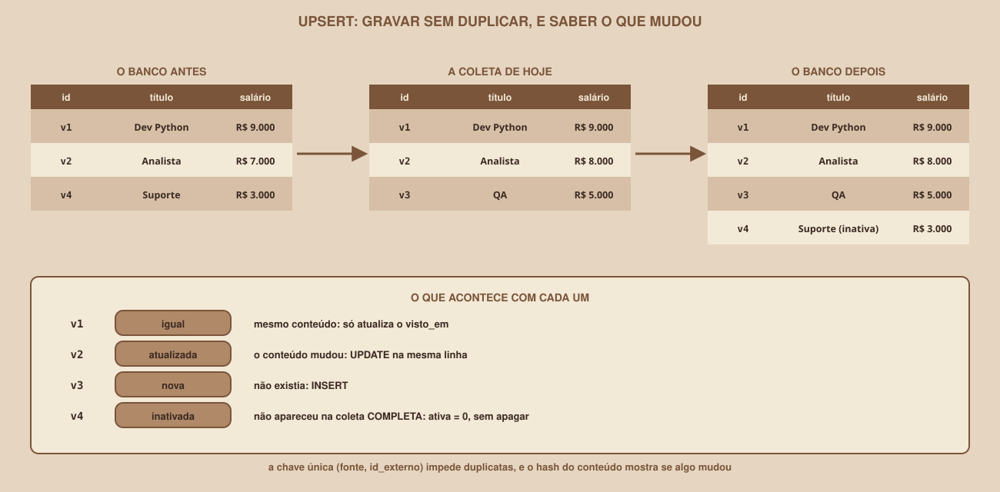

# Módulo 10, SQLite: Guardando os Dados

Português · [English](../docs-eng/10-sqlite-storing-the-data.md)

`SEM 07 // Data & Scraping, Parte 1: Coleta`

---

## // Antes de começar

Até aqui, os dados coletados viviam na memória ou em um arquivo JSON, e cada execução recomeçava do zero. Um pipeline de verdade precisa **guardar** o que coletou, e fazer duas coisas que o JSON não faz bem: **não duplicar** a mesma vaga a cada execução, e **perceber o que mudou** de um dia para o outro. Este módulo apresenta o banco de dados que faz isso, e não exige nenhum conhecimento prévio de SQL.

## // O que é um banco, e por que o SQLite

> **BANCO DE DADOS: EM PALAVRAS SIMPLES**
> É um programa que guarda dados em **tabelas** (linhas e colunas, como uma planilha), e que sabe responder perguntas sobre eles, com uma linguagem chamada **SQL**. A diferença para uma planilha: o banco **impõe regras** (por exemplo, "não pode haver duas vagas com o mesmo id"), e responde a consultas sobre milhares de linhas em instantes.

O **SQLite** é um banco que cabe em **um único arquivo**, não precisa de servidor, e já vem com o Python (o módulo `sqlite3`). Por isso é ideal para estudar e para projetos pequenos. Este material foi verificado com o SQLite **3.45.1**. O recurso de "upsert" que usaremos exige uma versão recente (a partir da 3.24).

## // SQL mínimo

O SQL tem poucos comandos, e você usará estes:

| Comando | Faz | Exemplo |
|---|---|---|
| `CREATE TABLE` | Cria uma tabela | `CREATE TABLE vagas (...)` |
| `INSERT` | Acrescenta uma linha | `INSERT INTO vagas VALUES (...)` |
| `SELECT` | Consulta | `SELECT titulo FROM vagas WHERE ...` |
| `UPDATE` | Altera linhas existentes | `UPDATE vagas SET ativa = 0 WHERE ...` |
| `WHERE` | Filtra | `WHERE salario_max >= 1000000` |
| `ORDER BY` | Ordena | `ORDER BY salario_max DESC` |
| `GROUP BY` | Agrupa, e conta | `SELECT modalidade, count(*) ... GROUP BY modalidade` |

Os tipos que usamos: `TEXT` (texto), `INTEGER` (inteiro). E as **regras de uma coluna**: `PRIMARY KEY` (identifica a linha, e não se repete), `NOT NULL` (não pode ficar vazia) e `UNIQUE` (não pode se repetir).

Este script (`10_a_sqlite_basico.py`) mostra o ciclo todo, em um banco temporário na memória:

```python
import sqlite3

conn = sqlite3.connect(":memory:")
conn.row_factory = sqlite3.Row
conn.execute("""
    CREATE TABLE vagas (
        id_externo TEXT PRIMARY KEY,
        titulo     TEXT NOT NULL,
        modalidade TEXT,
        salario_max INTEGER
    )
""")

dados = [("v1", "Dev Python", "Remoto", 900000),
         ("v2", "Analista de Dados", "Híbrido", 700000),
         ("v3", "DevOps", "Remoto", None)]
conn.executemany("INSERT INTO vagas VALUES (?, ?, ?, ?)", dados)
print("linhas:", conn.execute("SELECT count(*) FROM vagas").fetchone()[0])
```

```
linhas: 3
```

O `row_factory = sqlite3.Row` faz cada linha se comportar como um dicionário (`linha["titulo"]`). E repare nos `?`: são **parâmetros**, e os valores vêm separados, na lista. Por que isso importa está mais abaixo.

## // A chave que impede duplicatas

A coluna `id_externo` é a `PRIMARY KEY`. Se você tentar gravar uma segunda vaga com o mesmo id, o banco **recusa**:

```
IntegrityError: UNIQUE constraint failed: vagas.id_externo
```

Isso é uma proteção valiosa: mesmo que o seu código tenha um defeito, o banco não aceita a duplicata. Para saber que duas coletas falam da **mesma** vaga, precisamos de um id que o próprio site dá: o `data-id` que você viu no Módulo 02.

## // O upsert: criar ou atualizar

E se a vaga já existe, mas o salário mudou? Recusar não serve: você quer **atualizar**. O comando que faz "insira, e se já existir, atualize" se chama **upsert** (de *update* mais *insert*):

```
INSERT INTO vagas VALUES (?, ?, ?, ?)
ON CONFLICT (id_externo) DO UPDATE SET
    titulo = excluded.titulo, salario_max = excluded.salario_max
```

O `excluded` se refere aos valores novos que você tentou inserir. Rodando duas vezes, com uma vaga existente e uma nova:

```
linhas: 4
v1 agora: {'id_externo': 'v1', 'titulo': 'Dev Python Sênior',
 'modalidade': 'Remoto', 'salario_max': 1200000}
```

(A saída real escreve o dicionário em uma linha só.)

Quatro linhas (e não cinco): a `v1` foi **atualizada**, e a `v4`, **criada**.

<div align="center">

</div>

## // Saber o que mudou: igual, atualizada, nova e inativada

O desenho mostra o que queremos de cada coleta: para cada vaga, classificá-la em uma de quatro situações. A pergunta "mudou?" é respondida com a **impressão digital** (`conteudo_hash`) do Módulo 08: guardamos a do conteúdo na última coleta, e comparamos com a de agora.

| Situação | Como o pipeline percebe | O que faz |
|---|---|---|
| **Nova** | O id não existe no banco | `INSERT` |
| **Atualizada** | O id existe, mas a impressão digital mudou | `UPDATE` na mesma linha |
| **Igual** | O id existe, e a impressão digital é a mesma | Só atualiza `visto_em` |
| **Inativada** | Estava ativa, e **não apareceu** nesta coleta | `ativa = 0`, **sem apagar** |

Esta é a função `gravar`, do `banco.py`, que faz a classificação:

```python
def gravar(conn, tabela: str, itens: list, agora: str) -> Contagem:
    """Grava os itens sem duplicar. O nome da tabela é nosso, nunca do usuário."""
    contagem = Contagem()
    for item in itens:
        existente = conn.execute(
            f"SELECT * FROM {tabela} WHERE fonte = ? AND id_externo = ?",
            (item.fonte, item.id_externo),
        ).fetchone()
        for campo in getattr(item, "indisponiveis", ()):
            if existente is not None:   # não deu para ler hoje: mantém o antigo
                setattr(item, campo, existente[campo])
        linha = item.como_linha()
        hash_novo = item.conteudo_hash()
        if existente and existente["conteudo_hash"] == hash_novo:
            conn.execute(
                f"UPDATE {tabela} SET visto_em = ?, ativa = 1 "
                "WHERE fonte = ? AND id_externo = ?",
                (agora, item.fonte, item.id_externo),
            )
            contagem.iguais += 1
            continue
        colunas = ["fonte", "id_externo", *linha, "conteudo_hash",
                   "primeira_vez", "visto_em"]
        valores = [item.fonte, item.id_externo, *linha.values(), hash_novo,
                   agora, agora]
        atualizar = ", ".join(f"{c} = excluded.{c}" for c in
                              [*linha, "conteudo_hash", "visto_em"])
        conn.execute(
            f"INSERT INTO {tabela} ({', '.join(colunas)}) "
            f"VALUES ({', '.join('?' * len(colunas))}) "
            "ON CONFLICT (fonte, id_externo) "
            f"DO UPDATE SET {atualizar}, ativa = 1",
            valores,
        )
        if existente:
            contagem.atualizadas += 1
        else:
            contagem.novas += 1
    return contagem
```

E esta é a que inativa quem sumiu:

```python
def inativar_nao_vistas(conn, tabela: str, fonte: str, agora: str) -> int:
    """Marca como inativos os itens que não apareceram na coleta de agora."""
    cursor = conn.execute(
        f"UPDATE {tabela} SET ativa = 0 "
        "WHERE fonte = ? AND ativa = 1 AND visto_em < ?",
        (fonte, agora),
    )
    return cursor.rowcount
```

Dois cuidados importantes. **Não se apaga nada**: uma vaga que saiu do ar vira `ativa = 0`, e continua no histórico (e se voltar, é reativada). E **só se inativa depois de uma coleta completa**: se a coleta falhou no meio (digamos, na página 2), as vagas das páginas seguintes "não apareceram", mas não por terem sumido. O pipeline só chama a inativação quando a coleta foi **completa**. Ela é incompleta quando uma página da lista falhou, quando o limite de páginas foi atingido, quando a paginação entrou em **ciclo**, e quando um item **existe no site, mas veio quebrado** (uma vaga sem título, por exemplo): ele apareceu, e não pode ser tratado como "sumiu". O Módulo 12 detalha cada caso.

O mesmo cuidado vale para os **campos**. Na função `gravar`, repare no laço sobre `indisponiveis`: se hoje a página de detalhe falhou, a descrição **não é apagada**. O pipeline mantém a última descrição conhecida, e a vaga continua "igual" se nada mais mudou. Sem isso, um `503` passageiro de um minuto transformaria uma descrição boa em um vazio, e o histórico confiável seria degradado sem aviso.

## // O esquema da tabela de vagas

Este é o `CREATE TABLE` real da tabela `vagas`, que o pipeline cria:

```sql
CREATE TABLE IF NOT EXISTS vagas (
    id            INTEGER PRIMARY KEY AUTOINCREMENT,
    fonte         TEXT NOT NULL,
    id_externo    TEXT NOT NULL,
    titulo        TEXT NOT NULL,
    empresa       TEXT,
    cidade        TEXT,
    uf            TEXT,
    modalidade    TEXT,
    nivel         TEXT,
    salario_min   INTEGER,
    salario_max   INTEGER,
    publicada     TEXT,
    tags          TEXT,
    url           TEXT NOT NULL,
    descricao     TEXT,
    conteudo_hash TEXT NOT NULL,
    ativa         INTEGER NOT NULL DEFAULT 1,
    primeira_vez  TEXT NOT NULL,
    visto_em      TEXT NOT NULL,
    UNIQUE (fonte, id_externo)
);
```

Cada decisão tem motivo:

| Coluna | Por que existe |
|---|---|
| `id` | Um número interno, gerado pelo banco |
| `fonte` e `id_externo` | Quem é a vaga **no site**. `UNIQUE (fonte, id_externo)` impede duplicatas, e `fonte` deixa o esquema pronto para um segundo site |
| `salario_min`, `salario_max` | Em centavos, inteiros (Módulo 08). `NULL` quer dizer "não informado" |
| `tags` | As tags, em um texto separado por vírgulas |
| `conteudo_hash` | A impressão digital do conteúdo, para perceber mudanças |
| `ativa` | `1` enquanto a vaga aparece, `0` depois que some |
| `primeira_vez`, `visto_em` | Quando a vaga apareceu pela primeira vez, e quando foi vista pela última |

## // Rodando três vezes

Este script (`10_b_gravar_vagas.py`) coleta a lista de vagas e grava em um arquivo, classificando cada uma. Rodado em três momentos (dia 1, dia 1 de novo, e depois o dia 2 do site):

```
resultado desta execução: {'nova': 20, 'atualizada': 0, 'igual': 0}
vagas no banco: 20
resultado desta execução: {'nova': 0, 'atualizada': 0, 'igual': 20}
vagas no banco: 20
resultado desta execução: {'nova': 3, 'atualizada': 2, 'igual': 17}
vagas no banco: 23
```

A **segunda execução não mudou nada**: 20 vagas "iguais", nenhuma duplicada. Esta propriedade tem nome: **idempotência** (rodar uma vez ou dez dá o mesmo resultado). No dia 2, as 3 vagas novas entraram, as 2 de salário alterado foram atualizadas, e as 17 restantes ficaram como estavam. (Este script simplificado não inativa a vaga que sumiu, e por isso o total é 23: o pipeline completo, do Módulo 12, faz isso.)

## // Transações: tudo ou nada

Gravar 20 vagas são 20 comandos. E se o 12º falhar? Sem cuidado, o banco fica com 11 vagas, meio gravado. Uma **transação** agrupa os comandos para que valham **juntos ou nenhum**. Em Python, o `with conn:` faz isso: se algo levantar um erro lá dentro, tudo é desfeito.

```python
try:
    with conn:
        conn.execute("INSERT INTO t VALUES ('a', 1)")
        conn.execute("INSERT INTO t VALUES ('b', 2)")
        raise RuntimeError("falhou no meio")
except RuntimeError as e:
    print("erro:", e)
print("linhas gravadas:", conn.execute("SELECT count(*) FROM t").fetchone()[0])
```

```
erro: falhou no meio
linhas gravadas: 0
```

Zero linhas: as duas inserções foram desfeitas. E o contrário: sem `with conn:` (ou sem chamar `conn.commit()`), **nada é salvo de verdade**. Em um teste, uma conexão que gravou uma linha e foi fechada sem `commit` deixou **0 linhas** no arquivo.

## // Consultas que respondem perguntas

O ganho de ter os dados em um banco é fazer perguntas. Estes são resultados reais, sobre o banco que o pipeline completo gera (Módulo 12), depois de rodar o dia 1, o dia 1 de novo e o dia 2:

```sql
SELECT ativa, count(*) FROM vagas GROUP BY ativa;
```
```
[(0, 1), (1, 22)]
```

```sql
SELECT modalidade, count(*) n FROM vagas WHERE ativa = 1
GROUP BY modalidade ORDER BY n DESC, modalidade;
```
```
[('Remoto', 10), ('Híbrido', 6), ('Presencial', 6)]
```

```sql
SELECT titulo, inicio FROM eventos WHERE preco_centavos = 0
ORDER BY inicio LIMIT 3;
```
```
[('Python Day Curitiba', '2026-10-17T14:00'),
 ('Meetup de Dados', '2026-10-22T19:30'),
 ('Hackathon Cidades Inteligentes', '2026-11-07T09:00')]
```

(O último resultado foi quebrado em linhas para caber.) A ordenação funciona **porque as datas são ISO**: o texto `2026-10-17T14:00` ordena como uma data. E repare no `NULL`: para achar as vagas **sem** salário, não se usa `= NULL`, e sim `IS NULL`:

```sql
SELECT id_externo, titulo FROM vagas WHERE salario_max IS NULL;
```
```
[('v006', 'DevOps Júnior'), ('v013', 'UX Designer Pleno')]
```

## // Por que usar ? e nunca montar o SQL com f-string

Este é o erro de segurança mais clássico de quem trabalha com bancos, e ele existe **mesmo quando os dados vêm de um scraper**, porque o texto de uma página não é confiável. Veja o resultado real do mesmo trecho de código, escrito de dois jeitos, com uma entrada maliciosa:

```python
entrada = "x' OR '1'='1"
com_fstring = conn.execute(
    f"SELECT count(*) FROM vagas WHERE titulo = '{entrada}'").fetchone()[0]
com_parametro = conn.execute(
    "SELECT count(*) FROM vagas WHERE titulo = ?", (entrada,)).fetchone()[0]
```

```
f-string  achou: 4 linhas (a entrada virou parte do SQL)
parâmetro achou: 0 linhas
```

Com a f-string, o texto da entrada **virou parte do comando** e fez a condição valer para todas as linhas. Com o parâmetro `?`, o banco trata a entrada como **um valor**, nunca como comando. A regra: **valores sempre por parâmetro** (o `?`). (Só o nome da tabela, que é uma constante do seu código, pode ir em uma f-string, como faz a função `gravar`.)

## // Bom exemplo × mau exemplo

**Mau exemplo**: gravar sem se importar com duplicatas, e montar o SQL com f-string:

```python
conn.execute(f"INSERT INTO vagas VALUES ('{id}', '{titulo}')")
```

**Bom exemplo**: chave única, upsert, parâmetros e transação:

```python
with conn:
    conn.execute("INSERT ... ON CONFLICT (...) DO UPDATE SET ...", valores)
```

## // Erros comuns

Estas mensagens foram obtidas ao executar o código.

| Erro | Por que acontece | Como corrigir |
|---|---|---|
| `IntegrityError: UNIQUE constraint failed: vagas.id_externo` | Tentou gravar um id que já existe | Use o upsert (`ON CONFLICT ... DO UPDATE`) |
| `IntegrityError: NOT NULL constraint failed: t.a` | Faltou um valor em uma coluna obrigatória | Valide antes de gravar (Módulo 08) |
| `OperationalError: no such table: nao_existe` | A tabela não foi criada, ou o nome está errado | Rode o `CREATE TABLE`, e confira o nome do arquivo do banco |
| `ProgrammingError: Incorrect number of bindings supplied. The current statement uses 2, and there are 1 supplied.` | Há mais `?` do que valores (ou o contrário) | Conte os `?` e os valores |
| Os dados "somem" ao reabrir o banco | Faltou o `commit` | Use `with conn:` em volta das gravações |
| Uma vaga some do banco quando sai do site | O código apagou o que não viu | Marque `ativa = 0`, e não apague |

## // Prática guiada

1. Rode `10_a_sqlite_basico.py` e leia cada saída ao lado do código.
2. Rode `10_b_gravar_vagas.py` **duas vezes** (com o Mural Tech no dia 1) e confirme que a segunda não muda nada.
3. Troque o site para o dia 2 (`/_dev/dia/2`) e rode de novo. Confira as 3 novas e as 2 atualizadas.
4. Abra o arquivo `vagas_demo.db` com uma ferramenta de banco (por exemplo, o programa `sqlite3`, se você o tiver) e rode um `SELECT`.

## // Pratique sozinho

> **DESAFIO**
> Com o banco do `10_b_gravar_vagas.py` rodado no dia 1 (20 vagas), escreva uma consulta que conte as vagas com **salário máximo de pelo menos R$ 10.000**. Lembre-se: o banco guarda centavos, então o valor é `1000000`. Resultado esperado: **7 vagas** (`v003`, `v005`, `v008`, `v011`, `v012`, `v016` e `v017`).

## // Aplicando no projeto da semana

1. Na pasta do projeto, crie o `banco.py`, com o `ESQUEMA`, `abrir()`, `gravar()` e `inativar_nao_vistas()`.
2. Altere o `coletar_vagas.py` para gravar no banco em vez de no JSON.
3. Rode duas vezes e confira que o número de linhas não muda.
4. Coloque `dados/` no `.gitignore`: o banco é resultado, e não código.

## // Checkpoint

> **ANTES DE SEGUIR, PENSE NISTO**
> Uma coleta falha na página 2 de 3 (o site caiu por um minuto). As vagas das páginas 2 e 3 não foram vistas. Se o pipeline inativar "tudo o que não apareceu", o que acontece, e como o pipeline evita isso?

Resposta: as 12 vagas das páginas 2 e 3 seriam **marcadas como inativas por engano**, e a base passaria a dizer que elas saíram do ar, quando só não foram lidas. O pipeline evita isso só inativando depois de uma coleta **completa**: o coletor marca `completo = False` quando uma página da lista falha, e o orquestrador pula a inativação nesse caso. Há um teste automatizado para isso (Módulo 12).

## // Resumo do módulo

- [ ] Sei o que é um banco, e por que o SQLite serve para esta semana.
- [ ] Sei criar tabelas com `PRIMARY KEY`, `NOT NULL` e `UNIQUE`.
- [ ] Sei usar o upsert para criar ou atualizar sem duplicar.
- [ ] Sei classificar uma vaga como nova, atualizada, igual ou inativada, pela impressão digital.
- [ ] Sei usar transações (`with conn:`) para gravar tudo ou nada.
- [ ] Sei fazer consultas com `WHERE`, `ORDER BY` e `GROUP BY`, e usar `IS NULL`.
- [ ] Sei que valores vão sempre por `?`, nunca por f-string.

---

**Próximo módulo:** `11-robustez-e-boas-maneiras.md`, os dados já têm onde morar. Agora, fazer a coleta aguentar o mundo real.

`Material de Estudo // Coffee & Code`
