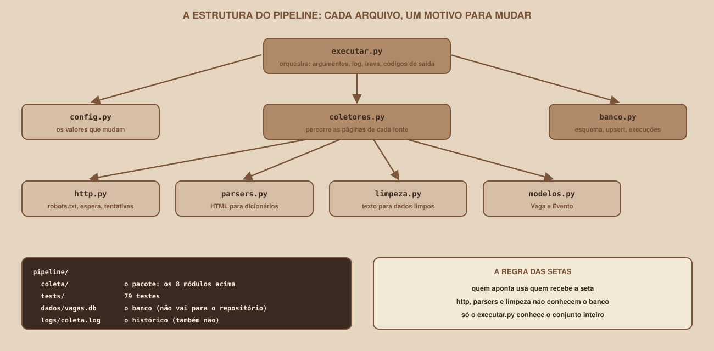

# Módulo 14, Projeto Guiado

Português · [English](../docs-eng/14-guided-project.md)

`SEM 07 // Data & Scraping, Parte 1: Coleta`

---

## // Antes de começar

Todas as peças estão prontas. Este módulo é o **fechamento da trilha principal**: você monta o pipeline completo, roda um roteiro de **14 verificações** com o resultado esperado de cada uma, e vê como levar o que construiu para uma fonte real, com cuidado. No fim, você tem o entregável da semana: **um pipeline de captura automática para o banco**.

## // A estrutura do projeto

<div align="center">

</div>

Cada arquivo tem **um motivo para mudar**:

| Arquivo | Muda quando... |
|---|---|
| `config.py` | Um valor de configuração muda (timeout, limite de páginas) |
| `http.py` | Muda a forma de pedir páginas (espera, tentativas, `robots.txt`) |
| `parsers.py` | O **HTML do site muda** (os seletores) |
| `limpeza.py` | Surge um formato novo de salário, data ou preço |
| `modelos.py` | Surge um campo novo para guardar |
| `coletores.py` | Muda o percurso de uma fonte (páginas, detalhes) |
| `banco.py` | O esquema do banco muda |
| `executar.py` | Muda como a execução é orquestrada (argumentos, códigos de saída, log) |

O ganho é prático: quando o site mudar o HTML (e vai mudar), **você sabe em qual arquivo mexer**: o `parsers.py`. Os outros sete não precisam saber.

## // Montando

1. Crie a pasta do projeto e copie para dentro dela as pastas `pipeline/` e `site-treino/`.
2. Dentro de `pipeline/`, crie o ambiente virtual e instale as bibliotecas:

```
python3 -m venv .venv
source .venv/bin/activate
pip install -r requirements.txt
pip install -r requirements-testes.txt
```

3. Em **outro terminal**, ligue o site de treino: `python3 servidor.py`, dentro de `site-treino/`.
4. De volta ao primeiro terminal, dentro de `pipeline/`, rode a coleta: `python -m coleta --espera 0.1`.

## // O roteiro de verificação

Os resultados esperados abaixo foram obtidos ao executar o roteiro de verdade. Para consultar o banco, use o comando `sqlite3 dados/vagas.db` (se você o tiver) ou um pequeno script Python com o módulo `sqlite3`.

| # | O que fazer | O que deve acontecer |
|---|---|---|
| 1 | Com o site ligado, abra `http://127.0.0.1:8080/` | A página inicial do Mural Tech aparece |
| 2 | Rode `python -m coleta --espera 0.1` | O log mostra `vagas: 20 novas, 0 atualizadas, 0 iguais, 0 inativadas` e `eventos: 8 novas, ...`, e termina com `ok (24 pedidos, 0 repetições)` |
| 3 | Consulte `SELECT count(*) FROM vagas` e `FROM eventos` | `20` e `8` |
| 4 | Rode **de novo** | `20 iguais` e `8 iguais`, e as contagens do item 3 **não mudam** |
| 5 | Consulte a vaga `v002` (`salario_min`, `salario_max`) e a `v001` (`cidade`, `uf`) | `700000` e `950000`; `Curitiba` e `PR` |
| 6 | Consulte o evento `e004` (`inicio`, `online`, `preco_centavos`, `preco_estudante_centavos`) | `2026-11-06T08:30`, `0`, `12000` e `6000` |
| 7 | Mude o site para o dia 2 (`curl http://127.0.0.1:8080/_dev/dia/2`) e rode | `vagas: 3 novas, 2 atualizadas, 17 iguais, 1 inativadas` e `eventos: 2 novas, ...` |
| 8 | Consulte a vaga `v003` (salário) e a `v015` (`ativa`) | `1500000` e `1900000`; `0` (inativa, e **não apagada**) |
| 9 | Rode `echo $?` logo depois de uma execução boa | `0` |
| 10 | Rode o pipeline **duas vezes ao mesmo tempo**, em dois terminais | A segunda sai com o código `3` e a mensagem "outra execução está em andamento" |
| 11 | Desligue o site, e rode | O código de saída é `2`, e a tabela `execucoes` tem uma linha com status `falha` |
| 12 | Rode `pytest -k proibida` | `1 passed`: o pipeline **não** visita uma página que o `robots.txt` proíbe |
| 13 | Rode `pytest -k 503` | `1 passed`: um `503` é repetido até funcionar |
| 14 | Rode `pytest` | `79 passed` |

Se algum item não bater, volte ao módulo correspondente: os itens 2 a 4 e 7 e 8 são do Módulo 10 e do 12; o 5 e o 6, do 08 e do 09; o 9 a 11, do 12; o 12 e o 13, do 03 e do 11.

## // O que os testes automatizados cobrem

O item 14 resume o seguro de vida do projeto. Dos 79 testes, **a maioria roda sem navegador e sem internet**: o Mural Tech sobe dentro do próprio teste, em uma porta livre, e o teste o liga e o desliga sozinho. Eles cobrem a limpeza (casos de salário, local, data e preço), a leitura do HTML, o cliente HTTP (`robots.txt`, esperas, tentativas), o banco (upsert, inativação, restrições) e o pipeline inteiro (idempotência, o dia seguinte, falhas, trava, códigos de saída, coleta incompleta e dado preservado).

O que os testes **não** conferem: o comportamento de **sites reais**, o `cron` em si e o Agendador do Windows. Para o primeiro, o roteiro da próxima seção é a sua defesa.

## // Do site de treino ao mundo real (opcional)

> **LEIA ANTES**
> Esta seção é opcional, e **nada dela foi testado contra um site real** na produção deste material. Antes de apontar o pipeline para qualquer site, percorra o desenho do Módulo 03: API oficial? Termos de uso? `robots.txt`? `Crawl-delay`? Dados pessoais? Se qualquer resposta for "não pode" ou "não sei", **pare**.

Se, depois disso, você tem uma fonte **permitida** (um site que autoriza a coleta, ou uma API pública), estes são os passos:

1. **Comece pequeno.** Rode com `--max-paginas 1` e `--so vagas`, e olhe o resultado antes de tudo.
2. **Salve uma página** (`curl -o pagina.html`) e escreva o plano de campos dela (Módulo 02).
3. **Ajuste o parsers.py**: os seletores. É o único arquivo que **precisa** mudar, na maioria dos casos.
4. **Ajuste a limpeza.py**, se os formatos de salário, data ou preço forem outros.
5. **Troque o endereço** (`--base-url`), o nome da fonte (`FONTE` no `coletores.py`) e o `User-Agent` (no `config.py`, com **um contato seu de verdade**).
6. **Escreva um teste com o HTML salvo**: uma página guardada em arquivo, e um teste que confira os campos extraídos. É a sua rede de proteção para quando o site mudar.
7. **Respeite o Crawl-delay** e **agende no máximo uma vez por dia**.

### Quando o site mudar

Vai mudar. O processo é o do Módulo 11: o alarme de campos vazios acende, você abre uma página nova, compara com a salva, **ajusta o seletor**, atualiza o HTML salvo do teste, e roda a suíte. Se o dono do site pedir para você parar, **pare**.

## // Bom exemplo × mau exemplo

**Mau exemplo**: apontar o pipeline para um site real **sem ler** nada antes, com o `User-Agent` de exemplo, e agendar de 5 em 5 minutos.

**Bom exemplo**: ler o `robots.txt` e os termos, testar com uma página só, identificar-se com um contato verdadeiro, guardar uma página de teste, e agendar uma vez por dia.

## // Erros comuns

| Erro | Por que acontece | Como corrigir |
|---|---|---|
| `ModuleNotFoundError: No module named 'coleta'` | Rodou fora da pasta `pipeline/` | Rode `python -m coleta` **dentro** de `pipeline/` |
| `ConnectionError` no `robots.txt` | O site de treino está desligado | Ligue o `servidor.py` |
| As contagens do item 7 não batem | O site não está no dia 2, ou o banco já tinha dados do dia 2 | Apague o `dados/` e refaça do dia 1 |
| O item 10 não dá código `3` | A primeira execução terminou rápido demais | Use `--espera 1` na primeira para que ela demore |
| Os testes falham por porta ocupada | Outro programa usa a porta | Os testes escolhem uma porta livre, então reinicie o terminal |

## // Prática guiada

1. Monte o projeto e percorra os 14 itens do roteiro, marcando cada um.
2. Tire um **instantâneo do banco** depois do item 7 (copie o arquivo `vagas.db`) e consulte-o.
3. Rode os testes, e depois **quebre algo de propósito** (por exemplo, apague um `?` de um `INSERT`) e veja qual teste acusa.

## // Pratique sozinho

> **DESAFIO**
> Troque o leitor de `robots.txt` do `http.py`, do `urllib.robotparser` para o **Protego** (Módulo 03). Você muda três pontos: o `pip install protego`, a criação (`Protego.parse(texto)`) e a pergunta (`can_fetch(url, agente)`, com a **ordem dos argumentos invertida**). Os testes de `robots.txt` do `test_http.py` devem continuar passando.

## // Aplicando no projeto da semana

Este módulo **é** a aplicação. O seu entregável (Checklist em `entregavel.md`) é o pipeline funcionando, com o roteiro conferido.

## // Checkpoint

> **ANTES DE SEGUIR, PENSE NISTO**
> Seis meses depois, você retoma o projeto. O site mudou, e os salários agora vêm vazios. O que você abre primeiro, e o que o projeto lhe dá para resolver rápido?

Resposta: você abre o `parsers.py`, porque é o único arquivo que conhece o HTML. O projeto lhe dá **o log** (que mostra campos vazios, se você acrescentou o alarme do Módulo 11), **a tabela de execuções** (que diz desde quando a coisa degradou), **o HTML salvo de teste** (para comparar a página antiga com a nova), e **os testes** (que dizem se o conserto quebrou outra coisa). Cada decisão de organização desta semana existe para que esse dia seja uma tarde, e não uma semana.

## // Resumo do módulo

- [ ] Montei o pipeline completo, e sei o motivo de cada arquivo.
- [ ] Percorri os 14 itens do roteiro, e os resultados bateram.
- [ ] Sei o que os testes cobrem, e o que eles **não** cobrem.
- [ ] Sei os passos para adaptar o pipeline a uma fonte real, e que devo parar se não houver permissão.
- [ ] Sei o que fazer quando o site mudar.

---

**Próximo módulo:** `15-scraping-assincrono-com-httpx.md` (**trilha veterano**). Quem quer coletar mais rápido, com cuidado, segue por aqui. Quem está na trilha principal pode ir direto ao `entregavel.md`.

`Material de Estudo // Coffee & Code`
