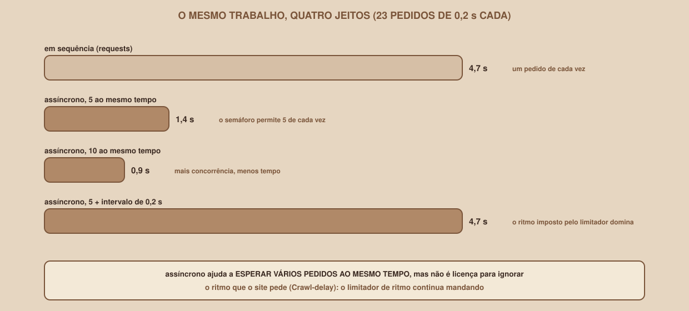

# Módulo 15, Scraping Assíncrono com httpx

Português · [English](../docs-eng/15-async-scraping-with-httpx.md)

`SEM 07 // Data & Scraping, Parte 1: Coleta` | **Trilha veterano**

---

## // Antes de começar

Este módulo é da **trilha veterano**: assume que você já escreveu scrapers com o `requests` (Módulos 05 a 07), e quer coletar **mais depressa**, sem perder as boas maneiras. Ele apresenta o `asyncio` e o `httpx` do zero, mas em ritmo de quem já programa. A ideia central, que vai se repetir: **assíncrono não é licença para ignorar o ritmo que o site pede**.

## // O gargalo é a espera

O scraper do Módulo 07 faz um pedido de cada vez. Em cada um, o programa **espera** a resposta chegar, sem fazer mais nada. Com um servidor que leva 0,2 segundo para responder, 23 pedidos custam, em sequência, 23 × 0,2 = **4,6 segundos**, e quase todo esse tempo é de espera, não de trabalho. A ideia da programação assíncrona: enquanto **um** pedido espera, **outros** podem sair.

## // O asyncio em poucas linhas

O `asyncio` é a biblioteca padrão do Python para isso. Três palavras bastam:

- **async def** cria uma função que pode "esperar" sem travar o programa (uma *corrotina*).
- **await** marca o ponto onde ela espera, e deixa o programa fazer outra coisa nesse meio-tempo.
- **asyncio.gather** roda várias corrotinas ao mesmo tempo, e devolve os resultados em ordem.

```python
async def tarefa(n):
    await asyncio.sleep(0.5)
    return n

# em sequência:
r = [await tarefa(i) for i in range(6)]
# todas juntas:
r = await asyncio.gather(*(tarefa(i) for i in range(6)))
```

```
em sequência: [0, 1, 2, 3, 4, 5] 3.0 s
com gather  : [0, 1, 2, 3, 4, 5] 0.5 s
```

Seis tarefas de meio segundo: 3,0 segundos uma depois da outra, e **0,5** todas juntas. Importante: tudo roda em **uma única linha de execução**. Não há paralelismo de processador; o ganho vem de aproveitar o tempo de espera. Por isso o `asyncio` ajuda em tarefas que **esperam rede**, e não em contas pesadas.

## // O httpx

O **httpx** (versão 0.28.1, nesta semana) é uma biblioteca de pedidos HTTP com uma interface muito parecida com a do `requests`, e com versão assíncrona (`httpx.AsyncClient`). Instale com `pip install httpx`. Duas diferenças que importam:

- O `requests` **não tem tempo limite padrão**, como você viu no Módulo 05. O `httpx` tem: `Timeout(timeout=5.0)`. Mesmo assim, **escreva o seu**, para o comportamento ser claro: `httpx.Timeout(10, connect=3)`.
- O cliente assíncrono se usa com `async with`, e cada pedido leva `await`: `resposta = await cliente.get(url)`.

## // Limitar a concorrência: o semáforo

Disparar 20 pedidos de uma vez é fácil, e é uma péssima ideia: você pode derrubar o site, ou ser bloqueado. O **semáforo** (`asyncio.Semaphore(n)`) deixa passar **no máximo n** de cada vez; os outros esperam a sua vez. Medindo o scraper assíncrono contra um servidor com 0,2 s de latência, com 23 pedidos (cada valor é a mediana de 3 execuções, e todas ficaram muito próximas):

| Concorrência | Tempo | Ganho sobre a sequência (4,7 s) |
|---|---|---|
| 1 (um por vez) | 4,7 s | nenhum |
| 2 | 2,6 s | cerca de 1,8 vez |
| 5 | 1,3 s | cerca de 3,6 vezes |
| 10 | 0,9 s | cerca de 5,2 vezes |
| 20 | 0,7 s | cerca de 6,7 vezes |
| 50 | 0,7 s | cerca de 6,7 vezes |

Duas coisas para notar. **O ganho tem um teto**: de 20 para 50, nada muda. O motivo é que a coleta tem **etapas que dependem umas das outras**: a página 1 vem primeiro (ela diz quantas páginas existem), depois as páginas 2 e 3, e só então os 20 detalhes. São três "ondas" de 0,2 s no mínimo, e nenhuma concorrência elimina essa cadeia. Uma conta simples descreve bem os números: o tempo é de cerca de `ceil(20 / c) × 0,2 + 0,4` segundos (com 5 de concorrência: 4 rodadas de detalhes de 0,2 s, mais 0,4 s das duas primeiras etapas, dá 1,2 s, e medimos 1,3 s).

> **UMA LIÇÃO SOBRE MEDIR**
> Em uma versão anterior deste material, o site de treino aceitava poucas conexões pendentes de uma vez (um limite pequeno do próprio servidor do Python), e as medições com concorrência alta ficaram **mais lentas e instáveis** (a concorrência 10 chegou a levar 1,7 s, contra 0,9 s depois da correção). O defeito era do servidor, e não do assíncrono. Quando uma medição parecer estranha, desconfie de **tudo** o que está no caminho, e não só do seu código.

## // Limitar o ritmo: o que o semáforo não faz

O semáforo limita **quantos ao mesmo tempo**. O `Crawl-delay` do Módulo 03 pede outra coisa: um **intervalo mínimo entre os pedidos**. São coisas diferentes, e para respeitar a segunda se precisa de um **limitador de ritmo**: uma peça que garante que o **início** de dois pedidos nunca fique mais perto do que o intervalo combinado, para todos os pedidos juntos.

```python
class LimitadorDeRitmo:
    """Garante um intervalo mínimo entre o INÍCIO de dois pedidos, para todos."""

    def __init__(self, intervalo: float):
        self.intervalo = intervalo
        self._proximo = 0.0
        self._trava = asyncio.Lock()

    async def esperar(self) -> None:
        async with self._trava:
            agora = asyncio.get_running_loop().time()
            espera = max(0.0, self._proximo - agora)
            self._proximo = max(agora, self._proximo) + self.intervalo
        if espera:
            await asyncio.sleep(espera)
```

A ideia: cada pedido pede a vez (`esperar`), e o limitador marca o próximo horário em que alguém pode sair. O `Lock` evita que dois pedidos reservem o mesmo horário. Com ele ligado a um intervalo de 0,2 s, o resultado muda completamente:

```
em sequência (requests):        23 pedidos em 4.7 s
assíncrono (conc.  5, intervalo 0.0 s): 20 vagas em 1.4 s
assíncrono (conc. 10, intervalo 0.0 s): 20 vagas em 0.9 s
assíncrono (conc.  5, intervalo 0.2 s): 20 vagas em 4.7 s
```

(Medições do `15_a_comparar.py`, repetidas três vezes, com variação de 0,1 s.) Na última linha, a concorrência continua 5, mas o limitador impõe 0,2 s entre os inícios, e o tempo **volta a ser o da sequência**: 23 × 0,2 = 4,6 s, e medimos 4,7. O limitador **manda**.

<div align="center">

</div>

A consequência prática: o `robots.txt` do Mural Tech pede 1 segundo entre pedidos. Com um limitador de 1 s, esses mesmos 23 pedidos levariam cerca de 23 s, como no Módulo 07, **por mais concorrência que você use**. (É uma conta, e não uma medição: a medição de 0,2 s mostrou que o limitador domina, e a de 1 s só amplia o efeito.)

> **QUANDO O ASSÍNCRONO COMPENSA**
> **Compensa**: coletar de **muitos sites diferentes** (cada um com o seu ritmo, e todos esperando ao mesmo tempo), baixar de uma API que declara um limite de uso generoso, ou lidar com respostas lentas. **Não compensa**: coletar de **um só site** que pede um intervalo entre os pedidos. Neste caso, ele só dá mais código para manter.

## // O coletor assíncrono

Esta é a função que baixa uma página com **semáforo**, **limitador** e **tentativas** (a versão assíncrona das ideias do Módulo 11, com a mesma política do pipeline principal: repete `429`, `502`, `503` e `504`). A pequena função `segundos_de` cuida do `Retry-After`: se ele não for um número (o padrão HTTP admite uma **data**), vale a espera crescente:

```python
def segundos_de(retry_after, padrao: float) -> float:
    """Retry-After pode ser um número ou uma data HTTP: se não der, o padrão."""
    try:
        return float(retry_after)
    except (TypeError, ValueError):
        return padrao


async def baixar(cliente, url, semaforo, limitador, tentativas=3,
                 dormir=asyncio.sleep):
    async with semaforo:                 # no máximo N pedidos ao mesmo tempo
        for numero in range(1, tentativas + 1):
            await limitador.esperar()    # e no máximo 1 a cada intervalo
            try:
                resposta = await cliente.get(url)
            except (httpx.TimeoutException, httpx.TransportError):
                resposta = None
            if resposta is not None and resposta.status_code not in RETENTAR:
                resposta.raise_for_status()
                return resposta
            if numero < tentativas:
                pedido = resposta.headers.get("Retry-After") if resposta else None
                espera = segundos_de(pedido, 0.5 * 2 ** (numero - 1))
                await dormir(espera)
        raise RuntimeError(f"{url}: sem sucesso em {tentativas} tentativas")
```

E esta é a coleta, que usa o `gather` em duas ondas (as páginas, e depois os detalhes). Repare no `return_exceptions=True`: **uma falha em um detalhe não derruba os outros**, e o laço seguinte decide o que fazer com cada resultado.

```python
async def coletar(base=BASE, concorrencia=5, intervalo=0.0):
    semaforo = asyncio.Semaphore(concorrencia)
    limitador = LimitadorDeRitmo(intervalo)
    cabecalhos = {"User-Agent": USER_AGENT}
    tempo = httpx.Timeout(10, connect=3)
    async with httpx.AsyncClient(headers=cabecalhos, timeout=tempo) as cliente:
        url1 = urljoin(base, "/vagas/")
        primeira = sopa(await baixar(cliente, url1, semaforo, limitador))
        rotulo = primeira.select_one(".paginacao span").get_text()
        total = int(re.search(r"de (\d+)", rotulo).group(1))
        urls = [f"{url1}?pagina={n}" for n in range(2, total + 1)]
        outras = await asyncio.gather(
            *(baixar(cliente, u, semaforo, limitador) for u in urls))
        vagas = ler_vagas_da_pagina(primeira, url1)
        for resposta in outras:
            vagas += ler_vagas_da_pagina(sopa(resposta), str(resposta.url))
        detalhes = await asyncio.gather(
            *(baixar(cliente, v["url"], semaforo, limitador) for v in vagas),
            return_exceptions=True)
        for vaga, detalhe in zip(vagas, detalhes):
            if isinstance(detalhe, Exception):
                vaga["descricao"] = None      # uma falha não derruba as outras
            else:
                vaga["descricao"] = ler_descricao(sopa(detalhe))
    return vagas
```

## // Os testes

Dos **79 testes** do pipeline, esta trilha acrescenta outros **16** (em `veterano/tests/`), dos quais 11 são do coletor assíncrono. Eles confirmam, entre outros pontos:

- o semáforo limita a concorrência (nunca mais de 3 ao mesmo tempo, em um teste com limite 3);
- o limitador espaça o início dos pedidos (nunca menos de 0,045 s, com intervalo de 0,05 s);
- um `503` é repetido, obedecendo o `Retry-After` quando existe (as esperas foram `2.0` e `1.0`);
- um `504` também é repetido, e um `Retry-After` em formato de data (que não vira número) cai na espera crescente, em vez de quebrar;
- um `404` não é repetido, e depois de 4 tentativas o coletor desiste;
- o assíncrono traz **os mesmos 20 ids** do sequencial;
- uma falha em um detalhe deixa `descricao: None` nele, e as outras 19 ficam intactas.

## // Bom exemplo × mau exemplo

**Mau exemplo**: disparar tudo de uma vez, sem limites, contra um único site:

```python
await asyncio.gather(*(cliente.get(u) for u in urls_das_20_paginas))
```

**Bom exemplo**: semáforo, limitador de ritmo, tempo limite e tentativas:

```python
await baixar(cliente, url, semaforo, limitador)
```

## // Erros comuns

Estas mensagens e resultados foram obtidos ao executar o código.

| Erro | Por que acontece | Como corrigir |
|---|---|---|
| `RuntimeWarning: coroutine 'f' was never awaited` | Chamou uma função `async` sem `await`: ela virou um objeto, e nunca rodou | Escreva `await f()` |
| `RuntimeError: asyncio.run() cannot be called from a running event loop` | Chamou `asyncio.run` dentro de código que já é assíncrono | Use `await` dentro de código assíncrono, e `asyncio.run` só na entrada |
| O assíncrono não ganha nada | Há um `time.sleep` (ou outra espera "bloqueante") dentro de uma função `async` | Use `await asyncio.sleep(...)`. Com `time.sleep(0.2)`, 5 tarefas levaram **1,0 s**, e com `asyncio.sleep(0.2)`, **0,2 s** |
| O site devolve `429` ou bloqueia | Concorrência alta, sem limitador | Use semáforo e limitador de ritmo |
| O programa derruba o site de treino | Sem semáforo | Limite a poucas dezenas, no máximo |
| Uma falha derruba tudo | O `gather` sem `return_exceptions=True` | Use `return_exceptions=True`, e trate cada resultado |
| Resultados fora de ordem | Esperava a ordem de **chegada** | O `gather` devolve na ordem de **entrada** |

## // Prática guiada

1. Rode `15_a_comparar.py` (com o site ligado) e confira os quatro tempos.
2. Rode o `coletor_async.py` com `concorrencia=1`, `2`, `5` e `10`, e preencha a tabela do módulo com os **seus** números.
3. Provoque o erro: coloque um `time.sleep(0.2)` dentro do `baixar` e meça de novo.
4. Rode `pytest tests/test_async.py` e leia os nomes dos testes.

## // Pratique sozinho

> **DESAFIO**
> Use a conta `ceil(20 / c) × 0,2 + 0,4` para **prever** o tempo da concorrência 4 e da concorrência 3. Depois, **meça** (com o site em `--latencia 0.2`). Resultado: a conta dá 1,4 s e 1,8 s, e a medição (mediana de 3 execuções) deu 1,5 s e 1,9 s. Por que o valor medido costuma ser um pouco maior que o da conta? (Dica: a conta ignora o tempo de abrir conexões, de ler o HTML e de agendar as tarefas.)

## // Aplicando no projeto da semana

1. Copie o `coletor_async.py` e o `parsers.py` para uma pasta `veterano/` do projeto.
2. Ligue o limitador ao `Crawl-delay` do `robots.txt` (leia-o com o cliente do Módulo 11), em vez de usar um valor fixo.
3. Meça o seu coletor contra o site de treino com e sem o limitador, e anote os números para o entregável.

## // Checkpoint

> **ANTES DE SEGUIR, PENSE NISTO**
> Você precisa coletar 5.000 páginas de **um único site** que pede 1 segundo entre os pedidos. Vale a pena fazer o coletor assíncrono?

Resposta: **não para ganhar velocidade**. Com um intervalo mínimo de 1 s entre os inícios dos pedidos, 5.000 páginas levam cerca de 5.000 s (uma hora e meia), com concorrência 1 ou 50. O assíncrono só ajudaria se o site **aceitasse mais pedidos** (o `robots.txt` e os termos são quem decide isso) ou se você estivesse coletando de **vários sites** ao mesmo tempo. A pergunta certa não é "como coleto mais rápido?", e sim "qual é o ritmo que o site aceita?". Responder a segunda é o que torna a primeira legítima.

## // Resumo do módulo

- [ ] Sei que o gargalo de um scraper é a espera da rede, e o que o `asyncio` faz sobre isso.
- [ ] Sei usar `async def`, `await`, `asyncio.gather` e `httpx.AsyncClient`.
- [ ] Sei limitar a concorrência com um semáforo, e que o ganho tem um teto.
- [ ] Sei limitar o **ritmo** com um limitador, e que ele é a peça que respeita o `Crawl-delay`.
- [ ] Sei isolar falhas com `return_exceptions=True`.
- [ ] Sei dizer quando o assíncrono compensa, e quando não.

---

**Próximo módulo:** `16-playwright-paginas-com-javascript.md`, até aqui, o HTML já vinha com os dados. E quando o JavaScript os monta depois?

`Material de Estudo // Coffee & Code`
